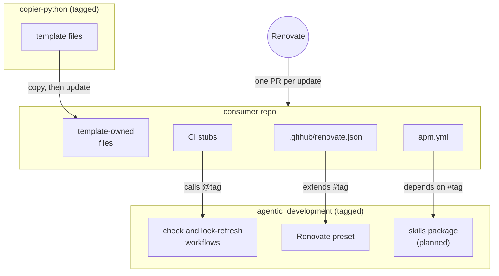

# High-Level Design: agentic_development

## Problem

When coding agents write most of a project's code, they write it faster than a developer can review line by line. The quality has to come from the process and its guardrails, not from a human reading every diff:

- strict lint and type checks that run constantly;
- tests that come first;
- review by agents before each commit.

Each repo needs the same baseline of tools and config, and keeping that baseline consistent by hand fails in three ways:

- **Copies drift.** A repo set up by copying last month's files misses this month's fixes.
- **Changes need hand edits everywhere.** When the baseline adds a file or a tool, each repo has to be edited separately, so most never are.
- **Guardrails don't hold on their own.** Agents skip steps that live only in prose: they write code before tests, stop reviewing early, and relax a check rather than fix the code.

## Approach

This repo holds two things. One is the shared pieces that other repos reference by version. The other is the design of the whole system. Components that live in other repositories keep their own design docs, which point back here.

### Copied baseline: copier templates

Files a repo must contain (tool configs, hook definitions, task definitions) are rendered into it by a copier template and committed. Renovate's copier manager proposes an update for each template release. It runs `copier update`, which replays the repo's own edits onto the new version. Templates live in their own repositories, one per layer, starting with [copier-python](https://github.com/jmbowman/copier-python).

Every file a template renders has one owner:
- **Template-owned** files are re-rendered on each update. A repo changes them through copier answers; a hand edit is a last resort that signals a missing answer.
- **Repo-owned** files are rendered once as a starting point and then belong to the repo. copier's `_skip_if_exists` leaves them alone on update and recreates them only if deleted.

### Referenced pieces: versioned by tag in this repo

Where a tool can pull shared config by reference, the repo holds only a small reference pinned to a release tag of this repo, and the shared content lives here:
- CI is a GitHub reusable workflow (`workflow_call`), and each repo's own workflow is a short stub that calls it.
- Renovate config is a shared preset, which each repo's Renovate config file extends.
- Agent skills shared by every repo ship as an APM package (planned), which each repo's `apm.yml` depends on.

Renovate's own managers bump those references (github-actions for the workflow, renovate-config for the preset, apm for skills), so each update arrives like any other dependency update.

### Process guardrails: skills and hooks, as later components

The development process (spec-driven with LID, tests first, review waves until convergence, a commit per slice) gets skills, hooks and a small state machine that enforce the parts agents tend to skip.

Skills come from two sources, both managed by APM through each repo's own `apm.yml`:
- **template-owned skills,** bundled as one APM package in this repo. A repo depends on it at a pinned tag, and APM resolves the bundle's own dependencies transitively;
- **repo-specific skills,** listed beside it.

The planned components, not yet designed:
- a commit-message skill and commit linting;
- path-scoped rule files for code authoring;
- review-wave orchestration with a commit gate;
- a spec-review loop around LID's design phases.

## Glossary

- **APM:** an agent package manager. It installs skills, prompts and plugins from git repositories at pinned versions, resolves their dependencies, and records them in a lock file.
- **copier:** a Python tool that renders a template repository into a project and later updates it, replaying the project's own edits.
- **Dependency sidecar:** a file `mise lock` writes beside `mise.lock` (under `.mise/locks/`) to pin the indirect dependencies of an npm- or Python-based tool. `mise.lock` records its digest.
- **Layer:** one template covering one concern (python, rust, documentation). A repo can apply several, each with its own answers file.
- **LID:** Linked-Intent Development, the spec process used here: HLD → LLDs → EARS specs → tests → code.
- **`lidc`:** a third-party CLI that checks LID's spec-to-test-to-code links.
- **mise:** a tool-version manager and task runner.
- **Named exception:** one relaxation of the strict baseline, written in a repo-owned file or as an inline suppression, scoped to the narrowest path, line or rule the tool allows.
- **prek:** a fast git-hook runner, compatible with pre-commit.
- **Renovate:** a dependency-update bot. Here it runs as the hosted GitHub app and opens a pull request per update, which merges automatically once CI passes.
- **ruff:** a Python linter and formatter.
- **Strict baseline:** the template's default checks, set as strict as each tool allows (for example, every ruff rule minus a commented list of exclusions, and every ty rule at error level).
- **ty:** a Python type checker (beta, so pinned exactly).

## Target Users

- **Developers who direct coding agents** across several repos, individually or as a team. They review designs and specs, and they commit each slice.
- **Coding agents** working in those repos, which need the rules and checks to be present and enforced without being told each session.
- **Teams evaluating the pattern.** It should be explainable and adoptable with mature open-source parts, without depending on anything specific to one person or organization.

## Goals

- A repo whose code passes the strict baseline, or whose existing violations are recorded as named exceptions, reaches the full baseline with one `copier copy`, a `mise lock` and a push, and passes CI on the first run. One-time onboarding also installs the lock-refresh GitHub App and adds its private key as a secret.
- A template or shared-config release reaches every consumer repo as an automatically merged update with no hand edits. A conflicting update means a file has the wrong owner or an answer is missing from the template.
- Every check runs in CI, and the fast ones also run at commit time.
- Each repo's named exceptions can be counted and paid down.
- Every release of a template, workflow or preset is exercised against a fixture consumer repo before it is tagged.

## Non-Goals

- **A configurable template product.** The templates encode one opinionated baseline. Options are added only when a consumer repo needs them, not to cover every possible preference.
- **Application scaffolding.** Templates add tooling to new or existing repos. They don't generate packages, CLIs or source layouts.
- **Supporting forges other than GitHub now.** Only GitHub is implemented. The design keeps forge-specific pieces isolated so that another forge (GitLab first) can be added later without restructuring; see Key Design Decisions.

## Tenets

Ordered: when two conflict, the higher one wins.

1. **Weigh license, maturity, active maintenance and fit for purpose.** Every tool choice accounts for all four. Fit for the task includes native support in the rest of the stack: copier was chosen for its suitability plus Renovate's built-in support for it.
2. **Reference over copy.** If a tool can pull shared config by a pinned reference, reference it, and copy only what can't be referenced.
3. **Strict by default, divergence named.** A repo starts at the strict baseline, and each relaxation is a named exception.
4. **Fast hooks, complete CI.** Commit-time hooks hold only checks fast enough not to interrupt work. CI runs everything.
5. **Automerge and fix forward.** Updates to tooling and templates merge automatically once CI passes. A bad release is undone by a new release, not prevented by holding updates for human review. The prerequisites are solid test coverage and rollback maturity. For this primarily local system, automerging and fixing forward is worth it.

## System Design

Renovate opens a separate pull request for each kind of update in a consumer repo:
- a template release (copier manager, which re-renders the template-owned files);
- a new tag of this repo's workflows (github-actions manager, in `ci.yml` and `lock-refresh.yml`), preset (renovate-config manager, in `.github/renovate.json`) or skills package (apm manager, in `apm.yml`);
- the tools pinned in the repo's own files.

The CI stubs (`ci.yml` and `lock-refresh.yml`) and `.github/renovate.json`, and `apm.yml` once the skills package exists, are rendered once by the template and then belong to the repo. Each template keeps its own files together in `.config/<template>/` (for example `.config/copier-python/`), and links to them from wherever a tool requires a file, so a repo's root stays nearly empty and a file's origin is visible from its path.

Components:

| Component | Lives in | Owns |
|---|---|---|
| CI workflows | this repo, `.github/workflows/` | The reusable check workflow each language layer's stub calls, what it requires a consumer repo to contain, the checks it runs, and its release tests against a fixture consumer. The reusable lock-refresh workflow that keeps a consumer's committed `mise.lock` current on Renovate's branches |
| Renovate presets | this repo | Shared Renovate behavior: automerge policy, the supply-chain delay, paths Renovate must not touch, the exception that holds LID pin bumps for a manual upgrade, and treating the lock-refresh App's commits as Renovate's own |
| copier-python | [copier-python](https://github.com/jmbowman/copier-python) (`../copier-python` locally), with its own design docs | The Python baseline files, their owners, and the template's own tests |
| Process skills and hooks | this repo (planned) | The template-owned skills package and hooks. Not yet designed |

Copier never edits the repo-owned reference files after the first render, and Renovate never edits template-owned files (the shared preset excludes them), so two update mechanisms never touch the same line.

**Versioning.** This repo and each template repo are released by git tag, `vMAJOR.MINOR.PATCH`. That form parses as PEP 440, the default versioning for Renovate's copier manager. Consumers pin references to a tag. A change that consumers must react to (a new requirement the workflow places on a repo, or a preset behavior change) is a major version.

## Key Design Decisions

- **copier plus Renovate, with committed files.** Rendered config is committed, so it's present on GitHub and in every clone without a bootstrap step. Template updates arrive as their own PRs, whose diff shows the effective change, separate from code changes. copier's update replays local edits with a three-way merge, and Renovate's copier manager runs it on the hosted app and commits the result, flagging conflicts in the PR. *Alternatives rejected:*
  - gitignored files generated from Pkl `amends` modules: a custom config language, PRs that hide the effective change, and config missing until bootstrap;
  - a fetch script: each repo still needs hand edits when the template adds a file;
  - projen: needs Node, and its generated `.gitignore` can't be regenerated by hosted Renovate.
- **Copied and referenced pieces live in separate repositories.** A repo has one tag stream. If the template lived here, every skill release would open a no-op template PR in every consumer, and separate template layers would be impossible. *Precedent:* GitLab's infra team keeps its copier template and its shared Renovate presets and CI tasks in separate projects.
- **Templates are declarative.** No copier tasks, migrations or Jinja extensions. Each of those requires `--trust`, which Renovate passes only when its admin allows scripts, so a declarative template is what lets the hosted Renovate app run updates unattended. Template-specific build-vs-adopt reasoning lives in each template's own HLD.
- **Lock files are committed, and refreshed on update PRs.** Consumers commit `mise.lock` and its dependency sidecars, so indirect dependencies change only through a PR that CI tests, and CI installs with `--locked` (mise-action does this whenever a lock file exists). Renovate's mise manager normally refreshes the lock for the pins it bumps. Template releases arrive through the copier manager, which doesn't, and the hosted app can't run `mise lock` as a post-upgrade task (its allowlist is `git add --all`, `git reset` and `pwd`). So a reusable lock-refresh workflow runs on Renovate's template-update PRs (those that change a copier answers file), runs `mise lock`, and pushes the result with a GitHub App installation token, because a push made with the workflow's own `GITHUB_TOKEN` doesn't start a new CI run. The workflow runs `mise lock` in mise's safe mode and mints the token only for the push, so new template config never runs next to a write token. The shared preset lists the App's commit author in Renovate's `gitIgnoredAuthors`: otherwise Renovate treats the PR as edited by someone else and stops updating or rebasing it. When Renovate rebases, it drops the lock commit and the workflow runs again; with nothing to change, it pushes nothing. The App's client ID isn't sensitive, so the template renders it into the stub from a copier answer. Each consumer holds only the App's private key, as a repository secret added at onboarding. The secret's name is a stable interface, and renaming it is a major version. Per-repo secrets are copies, a deliberate exception to *Reference over copy*. *Alternatives:* no committed lock files, or unlocked installs in CI (both let indirect dependencies change silently); self-hosted Renovate allowed to run `mise lock` (replaces the hosted app); a fine-grained personal access token (expires, and its commits look like the developer's); one repo that holds the App key and makes commits for the others (fewer secrets, but a server repo and more moving parts; a later option if per-repo secrets become a burden).
- **CI stubs pass no inputs.** A consumer's `ci.yml` stub only calls the reusable workflow, and the lock-refresh stub passes only the lock-refresh App's client ID and private key. The workflow takes everything it needs from files the template maintains in the repo (pinned tool versions and the `check` task), so a change in what CI runs travels through a template update, and stubs never need a hand edit. *Alternatives:* stubs that pass inputs (a breaking input change means hand-editing every stub); a template-owned stub whose tag copier renders (this ties the workflow's version to the template's, and Renovate's github-actions manager must be told to skip the file).
- **Forge-specific pieces are isolated.** Only these things depend on GitHub:
  - the CI definitions (this repo's reusable workflows, and the stubs that call them);
  - the GitHub App that pushes refreshed lock files;
  - the forge prefix in the preset reference (`github>`);
  - repository URLs;
  - the repo settings that platform automerge needs (applied at onboarding).

  Everything else is forge-neutral. The checks are mise tasks, the preset's policy is plain Renovate config, and the template files don't mention a forge. Each template asks a `forge` question (only `github` for now) that selects which CI stub and preset reference to render. Adding GitLab means a GitLab CI component in this repo that runs the same `mise run check`, a `gitlab` answer, and `gitlab>` references. No existing file changes owner.
- **Conflicts never automerge.** Renovate reports a conflicted copier update as an artifact error, which blocks automerge. A conflict-marker check in each repo's `check` task is a second guard, which also covers updates run by hand.
- **LID pin bumps are the one exception to automerge.** Moving a project to a new LID version needs a `/update-lid` walk of its design docs after merging, which the bump PR can't do. The shared preset therefore holds those updates for a person to merge.
- **Public repositories.** A public repo can call only public reusable workflows, and a private repo can call a private repo's workflows only after an access policy is set ([GitHub reference](https://docs.github.com/en/actions/reference/workflows-and-actions/reusing-workflow-configurations)). Public tooling repos remove that constraint for every consumer, and their content is configuration with no personal data.
- **LID for every component and every consumer.** Full mode, LID 1.3.0. The `lidc check` coherence gate blocks in commit-time hooks and in CI, a deliberate departure from LID's soft block, so local and CI checks enforce the same coherence.

**The tooling repos' own checks.** This repo isn't a template consumer yet. It has its own hand-written CI workflow, which runs `mise run check` from a root `mise.toml`, with the same strict profile and blocking `lidc` gate that consumers get. Its Renovate config extends the shared preset through an unpinned `local>` reference, so this repo always runs the preset on its own default branch. The shared check workflow isn't used here, because it requires `check` to come from `.config/mise/conf.d/`, which is reserved for template links and ignored by the preset. This changes once the template applies itself to its own repo.

## Success Metrics

- **Zero hand edits per release.** *Falsified by* more than 1 in 10 template, workflow, preset or skills update PRs needing a hand edit to merge.
- **First-run green:** a newly templated repo passes CI on its first push.
- **Shrinking divergence:** each repo's count of named exceptions goes down over time and never rises without a recorded reason.
- **Fast hooks:** commit-time checks finish in under 10 seconds on a typical slice.

## References

- [copier](https://copier.readthedocs.io); [Renovate copier manager](https://docs.renovatebot.com/modules/manager/copier/); [GitHub reusable workflows](https://docs.github.com/en/actions/reference/workflows-and-actions/reusing-workflow-configurations); [Renovate shareable presets](https://docs.renovatebot.com/config-presets/).
- [LID](https://github.com/jszmajda/lid) 1.3.0; [lid-tooling](https://github.com/EtaCassiopeia/lid-tooling) (`lidc`).
- Precedent: [GitLab common-template-copier](https://gitlab.com/gitlab-com/gl-infra/common-template-copier).
- Component: [copier-python](https://github.com/jmbowman/copier-python).
