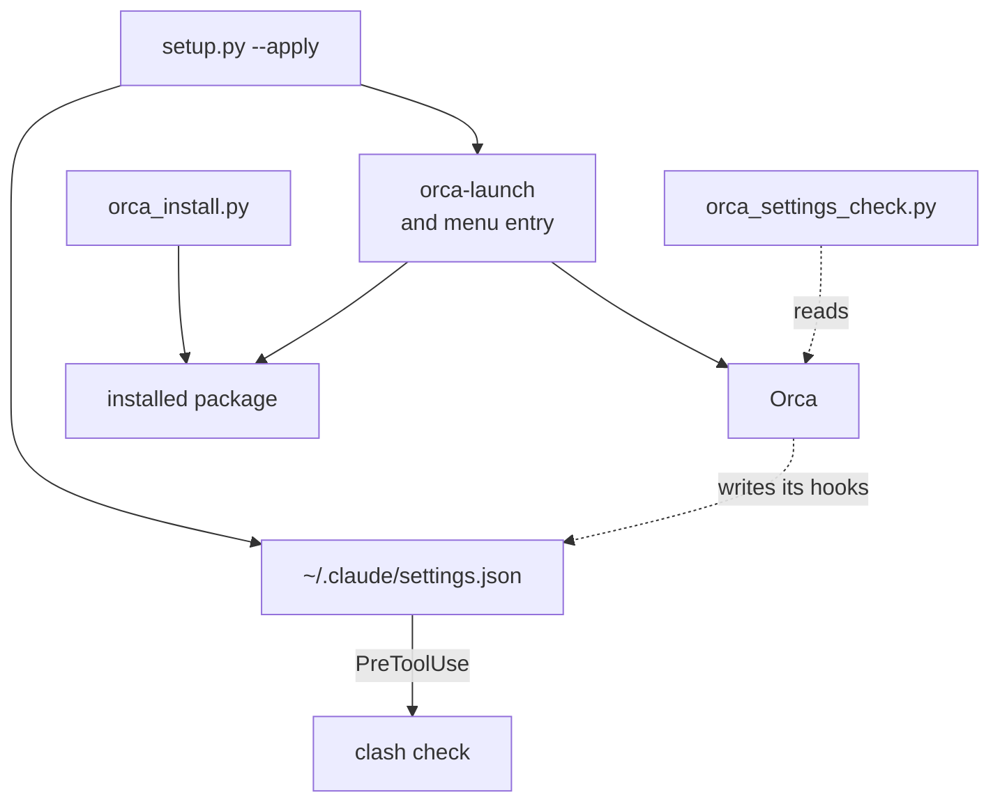
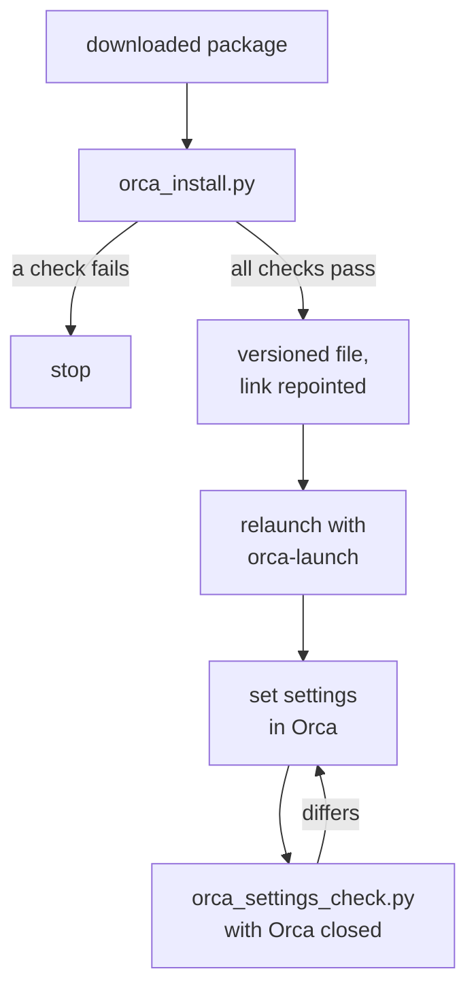

# Parallel sessions

## Context and Design Philosophy

A developer runs several Claude Code sessions at once, often in one repo, each in its own git worktree. [The parallel-session prior-art note](../../prior-art/2026-11-18-parallel-session-and-worktree-management.md) left two candidate setups: Orca, a desktop app that runs agents in worktrees and shows their state; and a blend built on Claude Code's own agent view. Orca also gives a session and terminal manager with readable, per-worktree tabs, so it's tried first (AD-335). The blend's custom pieces are designed and built only if Orca falls short (AD-348).

This component sets Orca up well on a developer's machine and fills the one gap the trial needs filled now: a warning before two worktrees change the same file, from Clash. It lives in `tools/parallel-sessions/`, is set up once per machine (HLD tenet 11), and isn't shipped to consumers. The [Orca guide](../../wiki/orca.md) is its user-facing companion.

Four principles shape it:
- **Show before changing user-wide configuration.** Every change to a user-wide configuration file (Claude Code's settings, the launcher, the menu entry) is shown as a diff first, and applied only on request, with a backup. The installer, which the developer runs on purpose with a file and a tag, writes only inside the install directory and never overwrites a package.
- **Check, don't fix, what another tool owns.** Orca's settings live in its own database, which it locks and migrates. This component reads them and reports what differs; the developer changes them in Orca.
- **Fail closed.** A script that can't finish its check says so with a failing exit status, never a passing one. Every script checks as much as it can, prints every problem it found, and exits with the most serious status: 2 (couldn't complete) over 1 (a check failed, or something differs) over 0.
- **Platform facts in one place.** The setup is meant for other developers' machines too. Everything that differs by operating system or architecture is held in one table (see Platforms), so supporting another platform adds rows rather than changing the scripts' logic.

## Platforms

The pilot supports Linux on x86_64 and arm64. Each platform-specific fact is one cell of this table, which the scripts hold as data:

| Fact | Linux x86_64 | Linux arm64 |
|---|---|---|
| Orca release manifest | `latest-linux.yml` | `latest-linux-arm64.yml` |
| Orca package in the manifest | `orca-linux.AppImage` | `orca-linux-arm64.AppImage` |
| Default install directory | `~/Applications/orca/` | `~/Applications/orca/` |
| Launcher | POSIX `sh` script in `~/.local/bin/`, defaulting to `$HOME/Applications/orca` when run from this repo | same |
| Menu entry | `~/.local/share/applications/orca.desktop` | same |
| Orca's user-data directory | `$XDG_CONFIG_HOME/orca` (default `~/.config/orca`) | same |
| Orca's profile database | `<user-data directory>/profiles/<profile>/profile-state.db`, with the profile `local-default` unless another is created | same |
| Orca's icon, at the release's tag | `resources/build/icon.png` in Orca's repository | same |
| Orca's process name (the command name of the process holding the profile database, seen on a running 1.4.269) | `orca-ide` | same |

On any other platform, each script that needs a platform fact stops with an error naming the platform, rather than guessing. macOS and Windows are planned (AD-347). Orca ships for both, with a different package on each (a `.dmg` or Homebrew cask on macOS, an installer on Windows), and a different way to give a desktop app an environment variable. Adding them means filling a column per platform and, where the install model differs, an install step per package type.

## Layout

| Path | What it is |
|---|---|
| `tools/parallel-sessions/orca-launch` | POSIX `sh` launcher for Orca |
| `tools/parallel-sessions/orca_install.py` | Verifies and installs a downloaded Orca package |
| `tools/parallel-sessions/orca_settings_check.py` | Reports Orca settings, installed files and hook entries that differ from the expected state |
| `tools/parallel-sessions/setup.py` | Shows, then applies, the machine-level setup |
| `tools/parallel-sessions/parallel_sessions_common.py` | What the three scripts share: the platform table, the config file, exit statuses |

The Python scripts carry inline script metadata, run with `uv run --script` from a checkout of this repo, use only the standard library, and pass this repo's strict lint profile. Each imports the shared module from its own directory, which `uv run --script` puts on the import path; that keeps the platform table in one place.

**The config file.** Machine-level settings for all the scripts live in `~/.config/parallel-sessions/config.toml` (under `$XDG_CONFIG_HOME` when it's set to an absolute path): the Orca install directory, and the minimum release age. It holds only what the developer chooses. No script writes it, and each uses the default (from the platform table, and 3 days) for anything it doesn't set, so a changed default reaches every machine. Paths in it may start with `~` or `~/`, which each script expands. An unreadable or malformed file, an unknown key, or a value of the wrong kind (a negative or non-integer number, a relative path) makes every script stop, listing every such problem, rather than fall back to a default.

**The network.** Only the installer uses the network: GitHub's releases API, the release's manifest and Orca's icon, over HTTPS, without credentials.

## Orca launcher and menu entry

Orca sends anonymous usage data unless `DO_NOT_TRACK=1` or `ORCA_TELEMETRY_DISABLED=1` is set, and official builds opt new profiles in. While either variable is set, Orca locks its telemetry toggle. So the only way to keep Orca from ever sending usage data is to set a variable at every launch.

The launcher:
- sets both variables to `1`, overriding any value already in the environment;
- runs the current package, `orca.AppImage` in the install directory (or `$ORCA_APPIMAGE` when set), with `exec`, so Orca's exit status is the launcher's. A `sh` script can't read the config file, so setup writes the install directory into the copy it installs;
- passes its own arguments through;
- stops with an error naming the path when the package is missing or isn't executable, rather than starting anything else.

Setup installs the launcher as `~/.local/bin/orca-launch`, and a desktop entry with:
- `Exec` set to the launcher's absolute path, because a desktop entry doesn't expand `~`, and a desktop session's `PATH` may lack `~/.local/bin`;
- `Icon` set to the absolute path of the icon the installer saved, and left out when there's none;
- `StartupWMClass=orca`, the window class Orca's window reports, so docks group the running window with the entry.

Desktop menus, docks and launchers then all start Orca the same way.

## Installing and upgrading Orca

`orca_install.py <package> --tag <tag>` takes a downloaded Orca package and the release tag it came from. It refuses to run on an unsupported platform (see Platforms). Before installing anything, it checks:
1. **The release is a published, stable release old enough to take.** It reads the release from GitHub's releases API. A tag that isn't found, a draft or a prerelease stops the install. So does a release whose `published_at` is younger than the minimum release age, unless `--allow-young` is passed.
2. **The file matches the release.** It fetches the platform's manifest for that tag from the release's download URL, and compares the file's sha512 (base64, as the manifest records it) and size with the manifest's entry for the platform's package name. The manifest's `version` must match the tag without its leading `v`.

Any failure to check (no network, a rate limit, a release with no manifest, a malformed manifest or install record) stops the install with an exit status of its own, distinct from a failed check. These checks prove the file is the published build, not who built it. AD-333's search may replace this step.

The checks run in a fixed order and stop at the first that fails. They include the install directory's own state (an existing versioned package with other content, `orca.AppImage` not being a link), so nothing is written, not even the install directory, until every check has passed.

Then it installs:
- It creates the install directory if needed.
- It copies the file to `orca-<version>.AppImage` there, through a temporary file renamed into place, and makes it executable.
  - If `orca-<version>.AppImage` already exists with the same content, nothing is copied.
  - If it exists with different content, the install stops.
- It records the version's sha512 in an install record, `install-record.json` in the install directory, so the settings check can later tell whether a version's file has been replaced.
- It repoints `orca.AppImage` at the new file, as a relative link, by replacing the link atomically.
- It saves Orca's icon from Orca's repository at the same tag (see Platforms), fetched from `raw.githubusercontent.com`, as `icon.png` in the install directory, for the desktop entry. Failing to fetch or write the icon doesn't fail the install, which is complete by then; it says so, and the desktop entry keeps whatever icon it had, or none.

Every request is HTTPS, and a redirect that leaves HTTPS counts as a request that failed. A tag with characters no release tag has stops the installer before it makes a request.

It never deletes an earlier version, so rolling back is repointing the link. It ends by telling the developer to quit Orca if it's running, re-run setup (which adds the icon to the menu entry once there is one), relaunch Orca, and run the settings check.

Orca's in-app **Update** replaces the running package file in place. Through the link, that rewrites a versioned file with another version's content. The Orca guide says to upgrade with the installer instead, and the settings check reports a versioned file whose sha512 no longer matches the install record.

## Orca settings check

`orca_settings_check.py` reports, without changing anything, where Orca's installed state differs from the expected state. It runs after the first launch and after every upgrade, because Orca's settings migrations can rewrite defaults. It exits:
- **0** when everything matches;
- **1** when something differs;
- **2** when it couldn't check. That covers: Orca running, Orca not having closed its database cleanly, the profile database not found or ambiguous (several profiles), the `settings` row missing or split across parts, a Claude Code version it can't read, and any other error.

It covers three things.

**Installed files.** Each versioned package file in the install directory must match the sha512 its install recorded, and `orca.AppImage` must be a link to one of them. The installed version is the one the link points at.

**Orca's settings.** Orca stores them as JSON in the `settings` row of the `profile_state_documents` table of its profile database (see Platforms). Orca can split a large document across `profile_state_document_parts`; it doesn't split `settings`, and a split `settings` row is a "couldn't check". The check opens the file read-only, and only while no Orca process is running, because Orca holds it open and may migrate it. When the user-data directory holds more than one profile, the check reports that it couldn't choose. It compares these settings:

| Setting | Expected |
|---|---|
| `agentPermissionDefault` | not `full-access` |
| `nativeChatPermissionMode` | not `full-access` |
| `autoRenameBranchFromWork` | `false` |
| `updateDelayDays` | at least the minimum release age |
| `automaticUpdates` | not `true` |
| `orchestrationCoordinatorApprovalsEnabled` | not `true` |
| `agentStatusHooksEnabled` | `true` |
| `deleteChatHistoryWithWorkspace` | not `true` |
| `alwaysForceDeleteWorktrees` | not `true` |
| `alwaysForceDeletePreservedBranches` | not `true` |
| `skipDeleteWorktreeConfirm` | not `true` |

The last four keep deleting a workspace from deleting more than the developer has seen: Claude Code chats, worktrees removed without a check, unmerged branches, or a removal with no confirmation dialog listing what's at risk.

A setting missing from the stored JSON takes Orca's default. The check holds a table of defaults for each Orca version whose source has been read. For any other version, a missing setting can't be judged, so the check reports it as "unset, default unknown" and exits 2. That tells the developer the table needs the new version's defaults. A setting with a value of the wrong type, JSON `null` included, is a difference.

**Orca's entries in `~/.claude/settings.json`.** Orca installs a hook entry only for the Claude Code events the installed Claude Code supports: each event has a first Claude Code version, and some events a later floor of Orca's own. When it knows the Claude Code version, it also removes its entries for events that version doesn't take. So the expected set depends on both versions. The check reads the Claude Code version from `claude --version`, takes the events Orca would install for it from the per-version table, and reports both directions of difference: an expected event that lacks Orca's script, and an Orca entry under an event that isn't expected. Either means the set of hooks changed in a way the table doesn't explain. A prerelease of Claude Code ranks below its release, as Orca ranks it, so `2.1.261-beta` doesn't reach a floor of 2.1.261. For an Orca version the table doesn't have, a Claude Code version it can't read, or a Claude settings file that isn't a JSON object with an object of hooks, the check reports that it couldn't check the hook entries, and exits 2.

An entry counts as Orca's when its command runs one of Orca's managed hook scripts by file name, as a whole path component. Orca manages scripts for several Claude-compatible CLIs, and one name can end another's (`openclaude-hook.sh` ends with `claude-hook.sh`).

The check opens the profile database as an immutable SQLite file, which is safe once no Orca process is running and creates no lock or journal files beside it. Orca keeps the database in write-ahead-log mode, and an immutable open ignores the log, so while a non-empty `profile-state.db-wal` sits beside the database, the main file may not hold the current settings. SQLite folds the log back in when Orca closes the database cleanly; a log left behind means it didn't, and the check says to start and quit Orca, and exits 2, rather than read settings that may be stale.

## Clash's hook

Orca has no warning about two worktrees changing the same file. Clash gives one. Setup adds one `PreToolUse` entry to `~/.claude/settings.json`, matching `Write|Edit|MultiEdit` and running `clash check`, the same entry Clash's own plugin declares. Clash then asks before an agent edits a file that another worktree has also changed, or that would conflict with another worktree's committed work.

Setup adds the entry only when:
- `clash` is on `PATH`;
- no equivalent entry exists;
- Clash's own plugin isn't enabled.

When the entry exists but `clash` is no longer on `PATH`, setup reports it and leaves it in place. When Clash's plugin is enabled but `clash` isn't on `PATH`, the plugin's hook can't run, so setup reports that too. Either makes the setup incomplete.

## Machine setup

`setup.py` brings one machine to the setup above.

**Showing.** By default it changes nothing: it prints each change it would make, as a unified diff for a file's content and as a line for a change of permissions. When a target is a symbolic link, the diff names the file it points to as well, and says when the link will be replaced.

**Applying.** `setup.py --apply` computes the changes again, prints them, and then makes those exact changes:
- It writes each file through a temporary file renamed into place, and only if the file hasn't changed since it read it, checked again just before the rename. If another program (Orca or Claude Code, which both write `~/.claude/settings.json`) changed the file in between, it leaves that file alone and says so. A write landing between that last check and the rename can still be lost; the window is a few milliseconds, and it's accepted.
- Before changing an existing file, it copies it into one backup directory, `parallel-sessions/backups/` under `$XDG_STATE_HOME` (default `~/.local/state`), named for the file and the run's UTC timestamp. The directory and copies are readable only by the developer, and copies carry no execute permission. Keeping backups there keeps secret-bearing copies of `settings.json` out of a dotfiles repository, and old launchers off `PATH`.
- A `settings.json` reached through a symbolic link, as with managed dotfiles, is written through the link: the temporary file goes beside the file the link points to, and the link stays in place. The launcher and the desktop entry are setup's own files, so a link there is replaced by a regular file and what it pointed to is left alone. That keeps `--apply` from rewriting a file elsewhere, such as this repo's own launcher when `~/.local/bin/orca-launch` links to it.
- When one write fails, it carries on with the remaining files, then reports.
- Running it again with nothing to change changes nothing, and makes no backups. A change is judged on content (for `settings.json`, on the parsed JSON) and on permissions.

Claude Code sessions don't need to be closed while it runs.

**The changes:**
- **The launcher:** an installed copy at `~/.local/bin/orca-launch`, with the install directory written in, so the menu entry doesn't depend on where, or on which branch, a checkout of this repo is.
- **The desktop entry.**
- **Clash's `PreToolUse` entry** in `~/.claude/settings.json`, appended. Setup writes the file as 2-space-indented JSON, keeping key order, and every other key and entry as it is, including Orca's. Writing it again as JSON also normalizes what JSON leaves open (number forms, duplicate keys, a byte-order mark); the diff shows any such change. A missing file is created.

**Prerequisites.** Before showing anything, setup checks that `git`, `uv` and `claude` are on `PATH`, and stops if any is missing. It reports whether `clash` is. It doesn't install Clash: it's pinned per machine in mise's global config, and setup prints the `mise use -g` command when it's missing. Without it, setup makes no Clash change.

**Outcome.** Setup exits 0 when it has made or shown every change, 1 when its summary names the setup as incomplete (a change skipped for a missing tool, a stale Clash entry, Clash's plugin without `clash`, or a file left alone because it changed underneath), and 2 on any other failure.

## Testing

Tests use pytest, run each script as a subprocess, and isolate it from the developer's machine. Each test builds the script's environment from scratch, with `HOME` and `XDG_CONFIG_HOME` pointing at temporary directories and `PATH` holding only stand-in commands, so nothing from the developer's environment (an `XDG_STATE_HOME`, a token) reaches it, and runs it in its temporary directory as working directory.

- **Installer:** the release URLs can be redirected to local fixture files, so no test touches the network.
- **Settings check:** reads a fixture database built with Orca's schema.
- **Setup:** runs against fixture settings files, checking:
  - its diffs and its backups;
  - that a second run changes nothing;
  - that unrelated keys survive;
  - that a file changed between reading and writing is left alone.
- **Launcher:** run with a stand-in package that records its environment, arguments and exit status.

The Python scripts run on the interpreter the project venv was made from, so an import outside the standard library fails as it would under `uv run --script`. A shim (`tests/parallel_sessions_shim.py`) replaces each script's boundaries with the machine's: the platform, `urllib.request.urlopen`, and the list of running processes. That asks three things of the scripts, which its docstring lists: a `main(argv)` entry point, a `running_command_names()` function in the settings check, and writes that rename a temporary file into place.

## Related segments

- **Repo setup** ([design](../repo-setup/repo-setup-design.md)) owns what a new worktree of this repo needs from the main checkout: the APM-installed skills under `.claude/skills/`, and `.config/prior-art-sources.toml`. Without them, a worktree of this repo loads none of the APM-installed skills. Orca copies gitignored files listed in `.worktreeinclude` (literal paths only), and links gitignored directories listed in `worktree.sharedDirectories` in `orca.yaml`. Adding both, committed, is the next change to repo setup (AD-349).

## Decisions & Alternatives

| Decision | Chosen | Alternatives Considered | Rationale |
|---|---|---|---|
| Scope | Orca's setup, plus Clash for overlapping edits | Also building the blend's custom pieces (a gitignored-files guard, a session-count status line, Worktrunk's config) | Orca is tried first, and also serves as the developer's session and terminal manager. The blend's pieces are built only if Orca falls short (AD-348) |
| How machine-level changes are applied | A setup script that shows a diff by default, and with `--apply` recomputes, prints and writes it, backing up each file | Print snippets to paste by hand; a user-scope Claude Code plugin | Repeatable and testable, and nothing changes that the developer hasn't seen. Pasting by hand is error-prone. A plugin can't carry the launcher or desktop entry, and adds a version stream |
| Writing files other programs also write | Write through a rename, only if the file is unchanged since it was read | Refuse while Orca or Claude Code runs; plain read-then-write | Claude Code sessions are nearly always running, so refusing would block setup. A plain write could silently drop another program's change |
| How Orca is kept from sending usage data | A launcher that sets the variables at every launch, used by the menu entry | Setting `DO_NOT_TRACK=1` for the whole desktop session; the in-app toggle | The variable locks the in-app toggle, and turning the toggle off needs one launch with the variable unset, which official builds would report. A session-wide setting also works, but it changes every program that reads `DO_NOT_TRACK`, which is the developer's call; the Orca guide describes it as an option |
| Orca's settings | Checked read-only; changed by the developer in Orca | Written into Orca's database by the script | Orca locks and migrates the database and has no command-line way to change settings, so writing it could corrupt a profile or be undone by a migration |
| Platform support | One table of platform facts; Linux x86_64 and arm64 in the pilot, other platforms stopping with an error | Linux x86_64 only; all platforms from the start | The setup is meant for other developers' machines. A table keeps adding a platform to filling in facts, while the pilot stays testable on the platform at hand |
| Language | Python standard-library scripts run with `uv`, and a POSIX `sh` launcher | All shell; all Python | Parsing JSON, TOML and SQLite and testing them is plain in Python. The launcher only sets variables and runs one program, so `sh` keeps it free of `uv` |
| Clash's install | Pinned per machine in mise's global config, at the version the scripts were tested with; setup only checks for it | Setup installs it; per-repo pins | Tenet 11: tools that span repos are installed per machine, and repos check for them |
| Where setup's backups go | One backup directory under `$XDG_STATE_HOME`, private, with no execute permission | Beside each changed file | Beside the file, a backup of a symlinked `settings.json` lands in a dotfiles repository with its secrets, and a backed-up launcher stays runnable on `PATH` |
| A setup target that is a symbolic link | Write `settings.json` through its link; replace a linked launcher or desktop entry with a regular file | Write every target through its link; refuse when a link points into a git checkout | Dotfile managers link `settings.json`, and writing through keeps the link. The launcher and desktop entry belong to setup, and a link there most likely points at a source file, such as this repo's launcher, which writing through would rewrite |
| The config file | Holds only the developer's choices; no script writes it | Setup writes every default into it | Tenet 10: a default written into the file would never pick up a later change to the default |
| An Orca version whose source hasn't been read | An unset setting, and the hook entries, count as "couldn't check" (exit 2) | Count them as differences (exit 1) | Fail closed: what can't be judged isn't a difference, and exit 2 says the table needs the new version |
| Which hook events the check expects | The events Orca would install for the installed Claude Code version, read from `claude --version`; entries missing and entries unexpected are both reported | Only the events Orca installs for every Claude Code version; all the events Orca knows | The check exists to catch any unexpected change in the set of hooks. A fixed set either misses a gated event that vanished or reports one an older Claude Code never had |
| A write-ahead log left beside the profile database | "Couldn't check" (exit 2), saying to start and quit Orca | Read a temporary copy of the database and its log; open it read-only without `immutable` | The copy writes files the check promises not to write, and a non-immutable open can create a shared-memory file beside Orca's database. A clean quit folds the log in, so asking for one is cheap |
| Credentials for GitHub | None: anonymous HTTPS requests | Use `GITHUB_TOKEN` or `gh`'s token when present | An install needs three requests, well within GitHub's anonymous limit, and no credentials leave the machine |
| Orca release vetting | sha512 and size against the release's manifest, a stable published release, and a minimum release age | Taking whatever is latest; also checking a signature | Orca publishes no signature or build attestation for Linux. Age and integrity are what's available until AD-333 finds better |

## Open Questions & Future Decisions

### Deferred

1. **macOS and Windows** (AD-347). Their columns of the platform table, their install steps (a `.dmg` or Homebrew cask, a Windows installer), and how each gives a desktop app an environment variable.

## References

- [The parallel-session prior-art note](../../prior-art/2026-11-18-parallel-session-and-worktree-management.md), with what was verified in each tool's source.
- [The Orca guide](../../wiki/orca.md).
- [Tool feedback for Orca](../../tool-feedback/orca.md) and [Clash](../../tool-feedback/clash.md).
- Orca's [install docs](https://orca.dev/docs/install), for each platform's packages and update behavior.
