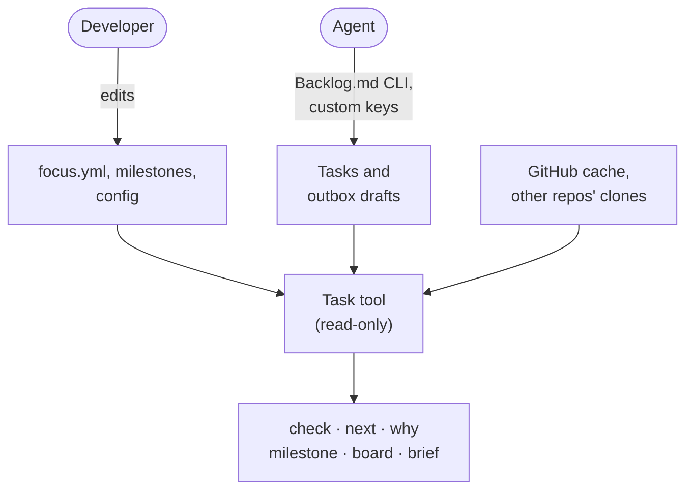
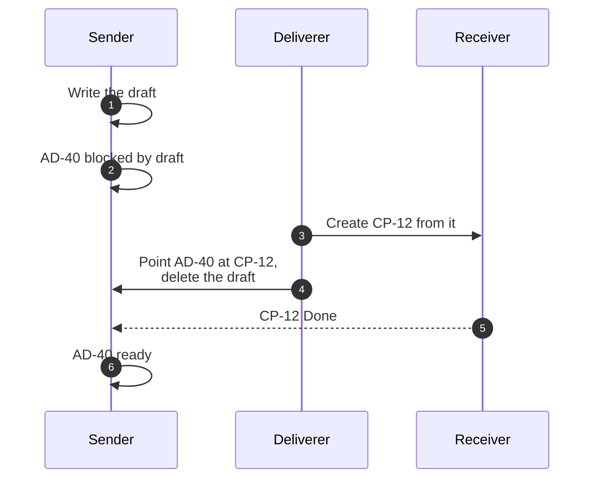
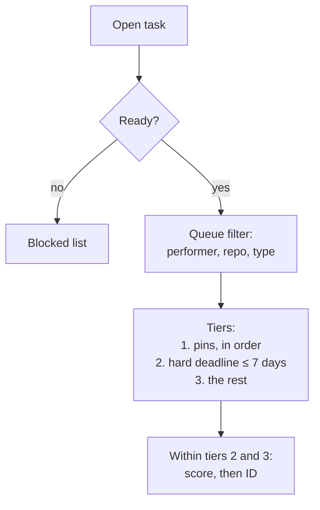
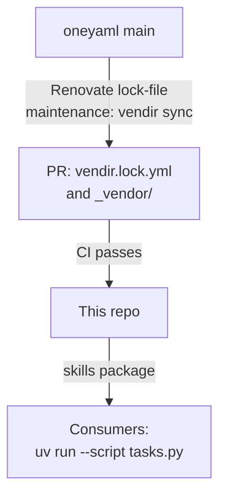

# Task tracker

## Context and Design Philosophy

A repo's outstanding work lives in its backlog: one Markdown file per task in the repo's backlog directory, in Backlog.md's file format. The tracker adds three things to that format: a few custom keys, a read-only task tool that lints the files and ranks the ready work, and a skill that tells agents how to pick up, record and finish tasks. The tool and the agents' rules ship together as the `task-tracker` skill in the skills package, and each template wires them into its consumers.

Three rules shape the design:

- **Facts and rulings in files, everything else computed.** A task file records what someone decided or observed: who does the task, how big it is, what it waits on, its priority. Readiness, rank, what a task unblocks, and the board are computed each time the tool runs, and never written back (HLD tenet 10). The tool never writes a task file.
- **The developer's rulings are visible and protected.** The developer's pins and ranking weights live in the focus file, which agents read and never edit. A `priority` the developer set is marked `priority_set_by: human`, and agents propose changes to it instead of making them.
- **Fail closed, explain every rank.** Anything the tool can't read (a GitHub issue, a task in another repo, a malformed date) blocks rather than unblocks, so nothing starts by mistake. Every score is printed with the terms that make it up, so the terms, not the numbers, are what a person reviews.

Arithmetic ranks the list, never a model. Agents propose a task's attributes when they create it; the ranking turns those attributes into an order.

Who writes what, and what the tool reads:

## Layout

All paths are relative to the backlog directory. The tool finds it the way Backlog.md does: the `backlog_directory` named in a `backlog.config.yml` at the repo root (a path inside the repo, whose config then lives in that root file), otherwise `backlog/`. `--root` overrides both. Moving the backlog, for example under `docs/` so a docs site can render it, is then a config change; `backlog/` is used below for the default.

| Path | Holds | Written by |
|---|---|---|
| `config.yml` | Backlog.md's settings, which the tool also reads: `project_name`, `task_prefix`, `statuses`, `types` | The developer |
| `tasks/` | Open and recently finished tasks, `<id> - <Title>.md`, where `<id>` is the lower-cased task ID | Agents and the developer |
| `completed/` | A legacy archive folder: older Backlog.md releases moved finished tasks here. Current releases read it as archived, never write it, and `backlog doctor --fix` moves its files into `archive/tasks/` | Older Backlog.md releases |
| `archive/tasks/` | Tasks Backlog.md has archived: taken off the board, whether finished or dropped | Backlog.md |
| `focus.yml` | The developer's pins, weight overrides and cache setting | The developer only |
| `README.md` | A pointer to the skill's format reference and the commands | The developer |
| `.cache/` | The GitHub lookup cache. Gitignored | The tool |
| `milestones/` | The workstreams tasks are grouped under, one file each (*Milestones*) | The developer, or an agent drafting for the developer's review |
| `outbox/<repo>/<slug>.md` | Task drafts for the repo `<repo>`, named by a slug | Agents draft; the developer delivers |
| `private/outbox/<repo>/<slug>.md` | A stopgap for drafts that can't be public, until the private coordination repo has a backlog (*Private work*). Gitignored, and kept in the main checkout | Agents draft; the developer delivers |

The tool loads the files directly in `tasks/` and in each `outbox/<outbox folder>/`, and `private/outbox/` only with `--private`. It treats `completed/` and `archive/tasks/` alike as archive folders, read only to look up an ID that no task in `tasks/` has (`completed/` first), so that a reference to an archived task resolves, and can be told apart from one to a task that never existed; archived tasks never appear in a queue, on the board or in the brief. Backlog.md's `drafts/` holds its own drafts (tasks not yet accepted onto its board, with `DRAFT-<n>` IDs); the tool doesn't read them as tasks, and lint reports any file there. It ignores Backlog.md's `decisions/` and `docs/` folders and anything else in the backlog directory. A missing backlog directory or settings file, a settings file that won't parse, or a `backlog_directory` that is absolute or leads outside the repo is an error: every command except `help` prints one line naming the problem and exits 2. With `--root`, the settings come from `config.yml` in that directory, and "the repo" is always the git repository that holds the backlog directory.

A repo is identified across repos by its forge path, `<host>/<owner>/<repo>` (`github.com/jmbowman/agentic_development`): prefixing `https://` gives its clone URL, and the form names no particular forge. The tool takes this repo's own forge path from its `origin` remote, normalized to that form, so a task file never states which repo it is in; a repo with no `origin`, or one whose `origin` is a local path, has no forge path, and a reference that names it reads as another repo's. Forge paths compare without regard to letter case, as GitHub's do. `config.yml`'s `project_name` is only Backlog.md's display name. Task IDs are `task_prefix` upper-cased, a hyphen and a token of letters and digits, with `.<n>` for each level of subtask (`AD-12`, `AD-12.1`). Backlog.md's `task create` assigns numbers in sequence, but the tool assumes only this shape, so a repo that assigns IDs another way, for example to avoid collisions between developers, keeps the rest of the tracker. Backlog.md's own file-name patterns expect numbers, so a scheme with letters must also be checked against Backlog.md's allocator and views (AD-327). Numeric parts compare without leading zeros, as Backlog.md compares them (`AD-01` is `AD-1`). IDs compare case-insensitively: the tool upper-cases them on reading.

**Open.** A task in `tasks/`, or a draft, is open when its `status` isn't `Done`, compared without regard to letter case as Backlog.md compares statuses. Any other status, including a missing one or one a repo adds to `config.yml`, is open. Archived tasks are never open, whatever their status. A draft belongs to the repo its `target` names.

## Task files

A task file is YAML frontmatter followed by a Markdown body, as Backlog.md writes it. Backlog.md keeps frontmatter keys it doesn't know when it rewrites a file, which is what lets the custom keys sit beside its own. A test in this repo runs the pinned Backlog.md CLI on a task carrying every custom key and fails if an edit drops or changes one, so an upgrade that breaks this fails `check`.

**Backlog.md's keys the tool reads.** `id`, `title`, `status`, `priority` (`high`, `medium`, `low`), `type`, `milestone`, `dependencies` (task IDs in the same backlog), `parent_task_id`, `created_date`, `due_date` and `references`. `status` is one of `config.yml`'s `statuses`, which must include `To Do`, `In Progress` and `Done`. `type` is one of `config.yml`'s `types` when it lists any. The types this repo and the template use are `bug`, `chore`, `decision`, `docs`, `eval`, `feature`, `review`, `search`, `spike` and `upstream`. A `search` is a task whose main output is a research record, normally a run of the prior-art-search skill that saves a note; a `spike` is a hands-on trial or probe. Labels say where a task came from (such as `issue`, `loose-end` or `prior-art`), not what kind of work it is.

**Custom keys.**

| Key | Values | Meaning |
|---|---|---|
| `performer` | `human`, `agent` | Who does the task. A task needing both is two tasks linked by `dependencies` |
| `agent_tier` | `fast`, `moderate`, `strong` | For an agent task: the weakest model class suited to it |
| `effort` | `S`, `M`, `L` | Well under an hour; about a session; several sessions |
| `external_blockers` | A list of references (below) | Blockers outside this backlog |
| `deadline_kind` | `hard`, `soft`, `target` | How firm `due_date` is. Without it, a `due_date` counts as `soft` |
| `defer_until` | A date | The task isn't ready before this date |
| `waiting` | Free text | Who is waiting for the task to be done |
| `priority_set_by` | `agent`, `human` | Who last set `priority`. Absent means `agent` |
| `sessions` | A list of session records (below) | The agent sessions that created, worked on or finished the task |
| `target` | A forge path, `<host>/<owner>/<repo>` | Outbox drafts only: the repo the draft is for |

A date is an ISO date, optionally followed by a time (`2026-12-01`, `2026-12-01 09:00`, `2026-11-17T12:18:00Z`); the tool reads the date as written when there is no time zone, and converts a time with a zone (`Z` or an offset) to the local date. Backlog.md writes `created_date` and `updated_date` as UTC timestamps, so without the conversion a task created late in the evening could read as created the next day. "Today" is the local date where the tool runs, so a deferral ends on the developer's day. Day counts are whole calendar days. A task file never carries `onStatusChange`, which Backlog.md runs as a shell command.

A session record is a mapping: `agent`, the harness that ran the session (`claude-code`); `id`, its session ID in that harness; `role`, one of `created`, `worked` and `finished`; and `date`. A session appears once per role. Records are added, never edited, so the list is the task's history of who touched it, and a person or agent can reopen a session for context (`claude --resume <id>` for Claude Code) while its transcript survives. A subagent's work is recorded under its parent session, whose transcript holds it.

`title`, `status`, `priority`, `performer` and `effort` are required, and so is `agent_tier` on an agent task: an absent one is a lint finding, as is a value outside the key's list. The other keys are optional. The tool ignores Backlog.md's `updated_date`, `reporter`, `project`, `ordinal` and `subtasks`; it finds a task's subtasks from their `parent_task_id`, never from the parent's `subtasks` list, which Backlog.md saves when present and can go stale. `waiting` counts as set only when it holds non-blank text.

**References between tasks and repos.** `dependencies` holds IDs in the same backlog. `external_blockers` holds three forms:

| Form | Names | Closed when |
|---|---|---|
| `gh:<owner>/<repo>#<n>` | A GitHub issue or pull request | GitHub reports it closed with its work done (see *GitHub lookup*) |
| `<host>/<owner>/<repo>#<ID>` | A task in that repo's backlog (`github.com/jmbowman/copier-python#CP-12`) | That task is `Done` at the repo's default branch, whether in its `tasks/` or its archive (*Other repos*). A reference to this repo resolves against the loaded backlog |
| `<outbox folder>/<slug>` | A draft in this backlog's outbox (`copier-python/add-the-backlog-scaffolding`) | Never: delivering the draft replaces the reference with the receiving task's `<host>/<owner>/<repo>#<ID>` (*The skill*, delivering a draft) |

A reference the tool can't read counts as open and is shown as unreadable: another repo with no local clone, a clone whose default branch lacks the ID, or a GitHub lookup that failed. It isn't a lint finding, since this run may simply not see the other repo. A reference to this repo's own tasks or outbox is different: one that names nothing is a lint finding, as a dependency would be.

A task in a public repo never references a private repo's task, which would name the private repo; the private repo carries any dependency between the two instead.

`references` lists what a reader should open: a URL, a path in this repo, or one of the reference forms above. It is the only list of links a task carries: Backlog.md's `documentation` key, a second free-text list of paths and URLs, isn't used, and lint reports a task or draft that has one. A path must be tracked by git, or at least not ignored: a reader of the repo on its forge can't open an ignored file. In an outbox draft, every entry must be a URL or a forge-qualified reference, because a path in this repo means nothing in the receiving one; the same goes for paths and spec IDs in the draft's body, which name their repo (`github.com/jmbowman/agentic_development`'s `PRIOR-ACC-012`) or link by URL.

**Outbox drafts.** A draft has the same keys as a task except `id` and `dependencies`, which the receiving repo assigns when it accepts the draft, plus `target`: the receiving repo's forge path. The outbox folder keeps a short, readable name (`outbox/copier-python/`), and every draft in one folder has the same `target`; the target travels with the draft when it is delivered. A draft's identity until then is `<outbox folder>/<slug>`. Its `priority` and `milestone` are the sender's proposals for the receiving repo. A draft is never a subtask, and has no `parent_task_id`. Drafts appear in their outbox folder's section of the board and in its `--repo` queue, in `why`, and in the Bottlenecks table when tasks here wait on them; they never appear in this repo's ready queues, its counts for the developer and agents, the brief, or milestone counts and groups.

## Milestones

A milestone is a workstream: the level at which a person asks what a body of work is for and how much it matters, above any one task. A milestone file has Backlog.md's frontmatter (`id`, `title` and an optional `due_date`) and a body of up to four sections:

- `## Description`: the big picture. What the workstream is for, and what done looks like for the workstream as a whole.
- `## Importance`: why it matters, or doesn't, now, and what waiting on it costs. Prose for people; a number that changes ranking belongs in the focus file.
- `## Related`: one bullet per related milestone, its ID and a phrase saying how they relate (`m-8`: needs this workstream's backlog location to render tasks in the docs site).
- `## References`: links to context outside the backlog, such as notes, design docs, issues and outside documents.

A task names its milestone by ID. Backlog.md also accepts a milestone's title or bare number, so lint reports a `milestone` value that isn't a milestone ID. Archived milestones (`archive/milestones/`) are read only when a lookup misses, as archived tasks are, so a task in an archived milestone still resolves, and lint reports it as needing a live one.

The body says what no single task says. It never lists tasks, their steps or their status: the tool computes a milestone's tasks and counts on read. Backlog.md keeps a milestone's body when it rewrites the file but writes back only `id`, `title` and `due_date`, so these details live in the body rather than in custom frontmatter keys.

## Private work

A public repo's tree never holds anything private. The developer's private tasks, and drafts that can't be public, live in the backlog of a **private coordination repo**: a repo the developer keeps private, which applies the same template and so runs the same task tool. A private draft is an outbox draft in that repo's `outbox/<target repo>/`, including private work for the public repo the agent is working in. Nothing is lost when a worktree of a public repo is removed, because no private file was ever in it.

An agent finds the coordination repo through `private_root`, the path to its checkout, in the per-machine settings (*Other repos*). Because the setting is tracked nowhere, a public repo never names the private one. With no setting, an agent writes no private draft and says so. A session that writes there needs its sandbox to allow that path.

The developer sees private drafts and tasks by running the task tool in the coordination repo, whose board shows its own outbox. Reading several repos' backlogs together is the portfolio view (AD-16).

Until the coordination repo has a backlog, private drafts stay in a public repo's gitignored `backlog/private/outbox/`, written in the main checkout, and `--private` loads them; both go away once the drafts have moved. A public repo's tasks never reference a private draft, so `check` gives the same answer with and without `--private`.

## Other repos

**Per-machine settings.** `$XDG_CONFIG_HOME/task-tracker/config.yml` (`~/.config` when the variable is unset) belongs to the machine, not to any repo, and holds:

- `private_root`: the path to the private coordination repo's checkout (*Private work*);
- `clone_roots`: directories where clones of other repos live, such as `~/Source`;
- `repos`: a mapping from forge paths to the paths of clones kept elsewhere.

A missing file or key means no clones and no private root. A value that isn't the right shape is reported by every command on standard error, and ignored.

**Finding another repo's clone.** For a reference to `<host>/<owner>/<repo>`, the tool tries the `repos` entry first, if there is one, and then `<root>/<repo>` under each of `clone_roots`, in order. A candidate counts only when its `origin` remote, normalized, is that forge path, so a directory with the same name but another origin is never read by mistake.

An outbox draft's life, for a task here that waits on work in copier-python:

Here the sender is this repo and the receiver copier-python; the deliverer is the developer or a session in copier-python. In step 1 the draft is `copier-python/add-scaffolding`, with `target: github.com/jmbowman/copier-python`, and step 2's blocker names it that way. In step 3, CP-12 references `github.com/jmbowman/agentic_development#AD-40`. In step 4, AD-40's blocker becomes `github.com/jmbowman/copier-python#CP-12`, and the deliverer runs `check`. Step 5 is read from the local clone of copier-python, at its default branch.

**Reading it.** The tool reads the other repo's backlog at its default branch's committed state, with `git show`, so whatever branch is checked out there, and any uncommitted edits, don't change the answer. The answer is as fresh as that clone's last fetch; the tool never fetches. It finds the other backlog directory as it finds its own (*Layout*), and the task by its ID among the file names in `tasks/` and then the archive folders. Reading other repos this way serves `<host>/<owner>/<repo>#<ID>` blockers; a combined view of several backlogs is the portfolio view (AD-16).

## The focus file

`focus.yml` is a mapping with four optional keys:

- `pins`: task IDs (or `<outbox folder>/<slug>` drafts) in the order the developer wants them done. A single ID may be written without a list. A ready pinned task comes first in any queue it belongs to, in pin order; a pin doesn't add a task to a queue whose performer or repo it doesn't match, and doesn't make a blocked task ready. A pin that names no open task is a lint finding.
- `weights`: a mapping from the weight names in *Ranking* to numbers (integers or decimals, negative allowed), overriding the defaults. A name that isn't one of them, or a value that isn't a number (a YAML boolean included), is a lint finding, and the default is used. The other constants in *Ranking* (the unblocks cap, the nearness curve, the firmness factors, the seven-day window) aren't configurable.
- `milestones`: a mapping from milestone IDs to numbers, an extra ranking term for every task in that milestone (*Ranking*). A key that names no milestone, or a value that isn't a number, is a lint finding, and the entry is ignored.
- `github_cache_hours`: how long a GitHub answer stays cached (*GitHub lookup*), a positive number, default 24. Any other value is a lint finding, and the default is used.

A missing file means no pins and default weights. The file's protection from agent edits is a path rule outside the tool (a permission deny and a commit check, AD-11); the tool only reads it.

## Readiness

A task is **ready** when all of these hold:

1. it is open;
2. every task in its `dependencies` is `Done`, wherever it was found (`tasks/`, `completed/` or `archive/tasks/`). An archived task that isn't `Done` was dropped (cancelled, a duplicate), so a dependency on it never resolves: a person must remove or re-point it, and lint reports it;
3. every entry in its `external_blockers` reads as closed;
4. its `defer_until` is absent or is on or before today. A `defer_until` that isn't a date defers the task indefinitely;
5. none of its subtasks (tasks whose `parent_task_id` is its ID) is open.

A task that isn't open has no blockers, and its external blockers are never looked up.

**What a task unblocks.** An open task *waits on* its open dependencies, the open tasks and drafts its forge-qualified and `<outbox folder>/<slug>` blockers name in this backlog, and its open subtasks. A task *unblocks* every open task, draft or not, that waits on it directly or through others; the count is computed over the whole backlog, before any queue's filters. It drives the `unblocks` ranking term and the board's Bottlenecks table. A task that waits on itself through this relation, by any mix of dependencies, blockers and subtasks, is in a cycle, which lint reports.

## Ranking

From an open task to its place in a queue:

A queue holds the ready tasks matching its performer and repo. It is ordered in three tiers:

1. **Pinned**: tasks in `pins`, in pin order.
2. **Imminent hard deadline**: tasks with `deadline_kind: hard` whose `due_date` is at most seven days away, or past.
3. **Everything else.**

Within tiers 2 and 3, tasks are ordered by score, highest first, then by ID in natural order (`AD-2` before `AD-12`, `AD-12` before `AD-12.1`; parts that aren't numbers compare as text).

The score is the sum of these eight terms. Each term's weight is the default below unless `focus.yml` overrides it. The defaults for priority, unblocks, due, active and age are Taskwarrior's urgency coefficients; those for effort and waiting are this design's own.

| Term | Weight name and default | Value |
|---|---|---|
| Priority | `priority_high` 6.0, `priority_medium` 3.9, `priority_low` 1.8 | The weight for the task's priority; nothing when it is absent or not a priority |
| Unblocks | `unblocks` 8.0 | weight × min(1, √(n / 16)), where n is the number of tasks it unblocks |
| Deadline | `due` 12.0 | weight × nearness × firmness. Nearness is 1 − 0.8 × (d + 7) / 21, clamped to [0.2, 1], where d is days until `due_date` (negative when past). Firmness is 1.0 for `hard`, 0.6 for `soft`, 0.3 for `target` |
| In progress | `active` 4.0 | The weight, when `status` is `In Progress` |
| Small effort | `effort_S` 2.0, `effort_M` 1.0 | The weight for `S` or `M`; nothing for `L` |
| Someone waiting | `waiting` 3.0 | The weight, when `waiting` is set |
| Age | `age` 2.0 | weight × min(1, days since `created_date` / 365), and nothing for a `created_date` in the future |
| Milestone | The focus file's `milestones` entry for the task's milestone; none by default | That number, when the focus file gives the task's milestone one |

A term whose date is absent or isn't a date contributes nothing; lint reports the bad date. The unblocks term grows with the square root so that one decision gating twenty tasks ranks well above one gating two without swamping every other term. Every listing prints each nonzero term with its label (`priority high 6.0`, `unblocks 5 (3 for agents) 4.5`, `hard deadline in 3d 10.3`, `milestone m-1 3.0`), where "for agents" counts the unblocked tasks whose performer is `agent`. A pinned task's terms start with `pinned #<n>`.

## Lint

`check` lints every loaded file (so private drafts only with `--private`), reports every finding as one line, `<task ID>: <problem>` or, when no ID could be read, `<file name>: <problem>`, and exits 1 when there is any. With none it prints `<n> tasks, no problems`, where n counts every loaded task and draft. Findings:

| Scope | Finding |
|---|---|
| A file | Frontmatter that isn't valid YAML (the file is then left out of every view, so tasks that depend on it get findings of their own); no `id` (tasks); an `id` that isn't `task_prefix`, a hyphen and a token of letters and digits with optional `.<n>` parts, when `config.yml` sets `task_prefix`; an `id` another loaded file already uses, in any folder; a file name that doesn't start with `<lower-cased id> - ` (tasks) |
| Required keys | A required key absent or outside its values (*Task files*); `priority_set_by` outside its values; `type` outside `config.yml`'s `types` |
| Dates | `created_date`, `due_date` or `defer_until` that isn't a date; `deadline_kind` outside its values, or without a `due_date` |
| Authority | A `decision` whose `performer` isn't `human`; `onStatusChange` or `on_status_change` in a task file or the settings file |
| Granularity | A human task whose body has a checklist line (`- [ ]` or `- [x]`) containing `[agent]`; a `Done` task with an open subtask |
| Links | A dependency, or a forge-qualified blocker naming this repo, that names no loaded or archived task; an `<outbox folder>/<slug>` blocker that names no draft in this outbox ("if delivered, replace it with the receiving task's forge-qualified ID"); a dependency on an archived task that isn't `Done` ("archived without being done"); a file in Backlog.md's `drafts/`; a `parent_task_id` that names no loaded task; a cycle in the waits-on relation (*Readiness*); an `external_blockers` entry in none of the three forms; a `references` path that git ignores (open tasks and public drafts only) |
| Links between keys | A task or draft with Backlog.md's `documentation` key ("move these links into `references`") |
| Drafts | A draft with an `id` or `dependencies`; a draft with no `target`, or a `target` that isn't a forge path; drafts in one outbox folder with different targets; a draft `references` entry that is neither a URL nor a forge-qualified reference |
| Focus file | Not a mapping; a `weights`, `milestones` or `github_cache_hours` entry that *The focus file* rejects; a pin that names no open task |
| Milestones | A task's `milestone` that isn't a milestone ID, names no milestone file, or names an archived milestone while the task is open; a `## Related` bullet that names no milestone; a milestone with open tasks whose `## Description` is missing, empty or Backlog.md's placeholder (`Milestone: <title>`) |
| Config | `statuses` missing `To Do`, `In Progress` or `Done`, or with `Done` anywhere but last (Backlog.md treats the last status as finished); `default_assignee` or `default_reporter` set (they fill `assignee` on every new task); `filesystem_only` set to anything but the boolean false (true turns off the branch scan when allocating IDs); `priorities` other than `high`, `medium` and `low`; `definition_of_done` set (finishing steps live in the skill) |
| GitHub blockers | A `gh:` blocker of an open task that the lookup cache records as closed without its work done, or as not found ("deleted, transferred or not visible to you: check it and re-point or drop the blocker"; GitHub answers the same way for all three) |

**Rules in code.** Every rule above is in the tool's code: the rules that concern one file's frontmatter alone (required keys, allowed values, date formats, and rules that tie one key to another, such as a `decision` needing `performer: human`), the values checked against `config.yml` (statuses, types), every rule spanning files (IDs, links, cycles, archive, subtasks), the milestone body rules and the body's `[agent]` checklist rule. The tool has no way for a repo to add rules of its own: a repo checks its own conventions about its tasks in its own tests (*This repo's backlog*).

Lint applies the rules about one file's keys and values to tasks and drafts, and the rules about links to open tasks and drafts only: a finished task's dropped dependency is history, not a problem. Archived tasks are checked only for frontmatter that won't parse and for IDs a task also uses. Each problem is reported once.

Lint never asks GitHub. It judges the files, plus the most recent answer GitHub gave for each blocker, which the cache keeps even after a later lookup fails: `next`, `why`, `milestone`, `board` and `brief` fill the cache and count lint problems after their lookup, and each prints the count of lint problems, so a blocker that will never close as done surfaces at the next session start instead of leaving its task blocked unnoticed. `check` stays fast and works offline; with an empty cache, as in CI, the GitHub blocker findings don't arise. Whether two tasks describe the same work is left to the agents' rules (below); a check for near-duplicate titles would be mostly noise.

## GitHub lookup

The lookup is a read-only check of the state of issues and pull requests that block tasks, in any repo. Tasks are not copied to GitHub issues: issues stay the public way in, each linked from the tasks made from it. A pull mirror of GitHub issues into local files (AD-18), if it is built, may answer the lookup for the repos it mirrors; the lookup never depends on it. The lookup needs the `gh` CLI, which this repo and the template pin through mise; without it, `gh:` blockers read as unreadable.

The commands that compute readiness (`next`, `why`, `milestone`, `board`, `brief`) look up the `gh:` blockers of every open task, drafts included. The references not answered from the cache go to GitHub through `gh api graphql`, each once, in as few requests as possible of at most 100 references, which read each one's state, whether a pull request was merged, and an issue's close reason. Each request has a 15-second timeout. `--offline` skips only GitHub; other repos' local clones are read either way.

A `gh:` blocker is closed when the issue is closed as completed, or the pull request is merged. An issue closed with no reason recorded, as issues closed before GitHub recorded reasons are, counts as completed. An issue closed for any other recorded reason (not planned, duplicate), or a pull request closed without merging, still blocks, shown as `closed without its work done`: the work the task waited for didn't happen here, so a person decides whether to drop or re-point the blocker. A reference GitHub reports as missing or inaccessible blocks, shown as `not found`, while the rest of the request's answers stand.

Answers are cached in `backlog/.cache/github.json`, which git ignores, for `github_cache_hours` from the focus file (default 24). Keeping the cache inside the repo lets a sandboxed agent, which may write only there, run the lookup. A request that fails as a whole (no `gh`, no network, not logged in, a timeout) marks every reference it carried as unreadable for ten minutes, so repeated runs without a network don't each wait for the timeout; it never replaces an answer still fresh in the cache. `--offline` skips the lookup, and every `gh:` blocker not already fresh in the cache shows as `not looked up` and blocks. The cache file is written whole and renamed into place, so two runs never read half a file.

## Reading YAML

The tool parses every YAML file it reads (frontmatter, `config.yml`, `backlog.config.yml`, `focus.yml`, the per-machine settings) with the pure-Python backend of [oneyaml](https://github.com/recursive-ai-oss/oneyaml-python), vendored in the skill at `scripts/_vendor/oneyaml-python/`. That directory mirrors the upstream repo's layout, keeping only the package at `src/oneyaml/` (without its `compat/` modules, stand-ins for other YAML libraries' interfaces, which the tool doesn't use) and the two license files at its top (MIT OR Apache-2.0). The tool puts `_vendor/oneyaml-python/src` first on its import path, so the vendored copy wins over any installed one; sets `ONEYAML_BACKEND=pure` in its own environment before importing it, the library's only public switch, so an invalid value found there can't stop the import; and parses with `oneyaml.loads` under the library's limits for untrusted input. It imports the parser only after reading the command, so `help` works without it. Only the parser's own errors mark a document as rejected; any other exception while parsing is a bug and surfaces as one.

A YAML document the parser rejects, in this repo or another one the tool reads, for bad syntax or for exceeding those limits, is treated as YAML that won't parse, with the consequence each file already has for that: task, draft or milestone frontmatter is left out and reported by lint, an unreadable `focus.yml` means the defaults and a lint finding, an unreadable per-machine settings file is reported and ignored (*Other repos*), and an unreadable settings file or `backlog.config.yml` is an error (*Layout*).

The tool reads YAML 1.2 under its core schema: an unquoted `2026-11-30` is a string, not a date, and `yes`, `no`, `on` and `off` are strings, not booleans. So:
- dates are always read as text and checked against their format (*Lint*);
- the booleans are the core schema's (`true`, `True`, `TRUE` and the matching forms of false), and a settings key that lint reports when it is on (such as `filesystem_only`) counts as on for any value other than the boolean false;
- a number is what the core schema reads as an integer or a float with a finite value, so not NaN, an infinity, or a literal too large to hold.

oneyaml publishes no releases or tags, so the vendored copy follows its `main` branch:

- this repo's root `vendir.yml` names the vendored directory with `ref: origin/main`, listing the license files explicitly (vendir's default legal-file patterns don't match `LICENSE-MIT` or `LICENSE-APACHE`), and the committed `vendir.lock.yml` records the commit vendored. vendir replaces the whole `_vendor/` directory on each sync, so nothing else lives there;
- Renovate's lock-file maintenance, which the shared preset turns on weekly through `config:best-practices`, runs `vendir sync` and puts the new lock and the changed vendored files in the one lock-file-maintenance PR it opens for every lock file it refreshes. That PR merges once CI passes (HLD tenet 6): platform automerge doesn't wait for Renovate's stability status, which stays pending for lock-file maintenance because it has no release date for the minimum release age. A failed sync turns that whole PR red, and a PR that fails CI stays open, as any failing Renovate PR does. A package rule in this repo's `.github/renovate.json` keeps lock-file maintenance on for the root `vendir.yml`, so a preset's package rule turning it off for vendir files elsewhere doesn't reach it; a preset that turned it off for the whole repo or the whole vendir manager would need a matching setting here instead, since Renovate decides those before package rules apply;
- a CI job runs `vendir sync --locked` and fails if the vendored files then differ from the committed ones, so the copy can't drift from the lock or be edited by hand. It needs the network, so it is not part of `mise run check`, and it runs only on changes to `vendir.yml`, `vendir.lock.yml` or `_vendor/`. If upstream rewrites or deletes `main`, the committed copy keeps working, and only changes to those files fail;
- `mise.toml` pins vendir. ruff and ty skip `_vendor/`, even when a hook passes its files by name, and ty resolves `oneyaml` from it through its extra search paths, since it doesn't follow the tool's own import-path change. The vendored copy is third-party code, kept as upstream wrote it, so it is the named exception to the HLD's rule that a script a skill ships passes the strict lint profile (HLD tenet 4).

## Commands

The tool is `scripts/tasks.py` inside the skill. It needs Python 3.11 or later and nothing else: it uses the standard library and the YAML parser vendored beside it (*Reading YAML*), declares no dependencies in its PEP 723 header, and has no lock file, so it runs alike as `python3 tasks.py` and `uv run --script tasks.py`. Its header sets `requires-python = ">=3.11"`, so under `uv run` uv uses an installed Python of that version or later, or provides one. 3.11 is the oldest Python still maintained upstream; it is also the first whose `datetime.fromisoformat` reads the date forms the tool accepts (*Task files*), and the vendored parser needs 3.10. This repo's own tooling targets 3.12, so a test runs the tool under 3.11 (*Testing*). Started directly on an older Python, or when the vendored parser won't import, every command except `help` prints one line naming the problem to standard error and exits 2. Repos run the tool through a `tasks` mise task, so the commands are `mise run tasks -- <command>`.

| Command | Output |
|---|---|
| `check` | The lint findings, or `<n> tasks, no problems`; exits 1 on any finding |
| `next [--for human\|agent\|all] [--type T] [-n N] [--repo R]` | The ready queue, ranked: ID, score, performer or tier, effort, title, then the terms. Default all performers and types, ten rows, this repo; `--type` keeps one type (`--type search` lists the searches ready to start); `-n 0` shows all; `--repo <name>` shows an outbox's drafts, `--repo all` everything. A `--type` that isn't in `config.yml`'s `types` is an error, exit 2 |
| `why <ID>` | One loaded task or draft, open or not (an archived one is shown as archived, with no rank): performer, status, repo, milestone title, its ranking tier and score with the terms, each open blocker, each task it unblocks, and its session records with the command that reopens each. An ID that names nothing loaded prints `no task <ID>` and exits 1 |
| `milestone <ID>` | One milestone: its whole body, then its open tasks' counts (ready, blocked, by performer), its ready tasks ranked, and its blocked tasks with what each waits on. An ID that names no milestone prints `no milestone <ID>` and exits 1 |
| `board` | The whole backlog as one Markdown page on standard output (below) |
| `brief` | The session-start summary (below) |
| `help` | The commands, without reading the backlog |

Two options go before the command: `--offline` (no GitHub lookup) and `--private` (also load `private/outbox/`, the stopgap in *Private work*). `--root <dir>` names the backlog directory, overriding the one *Layout* finds. `next`, `why`, `milestone` and `board` print their output and, when lint finds anything, a line on standard error saying how many problems `check` would report; they still exit 0, apart from an unknown ID. `brief` carries that count in its own output instead, and exits 0 except on the errors every command but `help` stops for (a missing or unreadable backlog or settings file, an old Python, a missing parser, a usage error). The developer's and agents' groupings on the board and in the brief are by `performer`; a task whose performer is neither appears in neither, and lint reports it.

**The board** has, in order: counts of ready, blocked and total open tasks for the developer, for agents and in the outbox; the open pinned tasks in pin order, each marked when it isn't ready; the developer's ready queue (top 25); the agents' ready queue (top 30); Bottlenecks (the 15 open tasks that the most others wait on, whether each is ready, and what it waits on); every blocked task with what it waits on; each outbox repo's drafts; and every open task grouped by milestone, each group headed by the milestone's title, the first sentence of its description and its `## Related` lines. Task IDs link to their files by paths relative to the working directory, wherever `--root` points. The board is a view to read, not a file in the repo; `mise run tasks -- board > /tmp/board.md` saves one. It can disagree with Backlog.md's own board: with `check_active_branches` on, Backlog.md shows the most progressed copy of a task found on any recently active local branch, while the tool reads only the working tree. The branch scan is kept for what it adds to ID allocation.

**The brief** is what a SessionStart hook shows an agent, so it follows HLD tenet 9: it reports what changes between sessions and prints nothing when nothing needs attention. It lists, each only when non-empty: tasks in progress; open pins; ready tasks with an imminent hard deadline; the top five ready agent tasks; the count of the developer's ready tasks with the top three; and the lint problem count. With every list empty it prints nothing.

## The skill

`skills/task-tracker/` in the skills package holds:

- `SKILL.md`: when to use it (picking up work, recording new work, finishing a task, filing work for another repo), the agents' rules below, and where they differ from Backlog.md's own instructions;
- `scripts/tasks.py`: the task tool;
- `scripts/_vendor/oneyaml-python/`: the vendored YAML parser (*Reading YAML*);
- `references/task-format.md`: the task file format, keys and reference forms, for agents and people writing tasks by hand.

Its frontmatter uses only the Agent Skills fields, and its instructions work in any agent that can run a shell (HLD tenet 8).

**Agents' rules.**

- **When to create a task.** Record work that is left outstanding beyond the current request: a loose end, a follow-up, a deferred spec, a decision the developer must make. Work done now, in the session that found it (exploration, a mechanical edit), needs no task.
- **A repo with no backlog.** The skill can be installed where no backlog exists, such as through the plugin. There, don't create a backlog directory or run `backlog init`: tell the developer the repo has no backlog, and leave the outstanding work in the reply. Setting up a backlog is the developer's decision, normally made through the repo's template.
- **Recording work.**
  - Before creating a task, search the backlog with a query, narrowed by filters such as status or type, not by listing everything, for one that covers the same work, and extend or link it instead.
  - Check the scope: one task is what one focused pull request would finish. Use subtasks for parts of one goal in one area, and `dependencies` for work across components.
  - The description gives the why: the problem or trigger, and the context a reader can't recover from the code. Acceptance criteria state testable behaviour, not implementation steps, and don't repeat the description. Leave the plan to whoever starts the task.
  - Create the task with `backlog task create`, which assigns the ID and names the file. Then add the custom keys to its frontmatter by hand, since the CLI has no option for them: `performer`, `effort`, `priority_set_by: agent`, for an agent task `agent_tier`, and a `sessions` record with role `created`. Run `check` afterwards.
  - If the `backlog` CLI won't run, don't write the task file yourself or choose its ID: tell the developer the CLI failed, and leave the outstanding work in the reply. An ID chosen by hand skips the allocator's scan of other worktrees and branches, so it can collide where the allocator's wouldn't.
- **Session records.** Add a record for the current session when creating a task (`created`), starting it (`worked`) and finishing it (`finished`), taking the session ID from the harness where it exposes one (in Claude Code, the `CLAUDE_CODE_SESSION_ID` environment variable). Where the harness exposes none, add no record.
- **Granularity.** A task is one thing for one performer. Split agent-doable work out of a task that waits on the developer, and link the two with `dependencies`; a task may depend on one created after it. Labels don't restate the type: a decision is `type: decision`.
- **Doing the work.**
  - Take the top of `next --for agent` unless the developer names a task. Read the task before changing it, including its `## Comments`, where the developer or a reviewer may have left guidance for whoever picks it up. Set `status: In Progress` when starting.
  - Comments (`--comment`, with `--comment-author` naming the session) are the asynchronous channel between people and agents on a task: guidance, review remarks, and questions that don't stop the work. A question that blocks the work becomes a `decision` task the work depends on. Progress goes in notes, not comments.
  - Record the plan with `--plan` (which replaces it) or `--append-plan`, and progress with `--append-notes`, briefly and in time order.
  - Don't widen the task silently: record extra work as a new task, or ask.
  - Work through subtasks one at a time, and finish a parent only when all of its subtasks are done.
- **Finishing.**
  - Tick an acceptance criterion only on evidence that the behaviour works, such as a passing test or an observed result. The presence of code, or a grep hit, isn't evidence.
  - Write a final summary (`--final-summary`) of what changed, why, how it was verified, and any risks, then set `status: Done`. A commit message, drafted separately, may cite the task.
  - A `decision` task's ruling is recorded in the document it governs (a design doc, a note, a config file), and the final summary links to it. Only when no document governs the choice does the final summary hold the ruling itself.
- **Milestones.** Put a task in the milestone whose description covers it, naming it by ID. Never change a milestone's `## Importance`, which is the developer's; an agent may draft or update the other sections for the developer's review, saying only what no single task says. Adding, renaming, archiving and removing milestones are the developer's.
- **Work for another repo** is an outbox draft in `outbox/<repo>/`, with the same keys except `id` and `dependencies`. Work that can't be public, for any repo, is a draft in the private coordination repo's outbox (*Private work*) when `private_root` is set and that repo has a backlog; otherwise, while this repo's main checkout has the stopgap folder, in its `private/outbox/<repo>/`; otherwise no draft is written, and the agent tells the developer. It carries `target`, the receiving repo's forge path, and names this repo's files by URL and this repo's tasks and specs by its forge path. The draft is the record; a message to a session in that repo, or an issue on it, is a way of delivering it.
- **Delivering a draft** is done by whoever delivers it (the developer, or a session in the receiving repo). The receiving repo creates the task with its own ID and lists the sending task in its `references` by forge path. Then, in the sending repo, every `<outbox folder>/<slug>` reference to the draft is replaced with the new task's `<host>/<owner>/<repo>#<ID>`, the draft is deleted, and `check` is run.
- **Private repos** are never named, and private drafts never referenced, in a public repo's tasks, drafts or references. When a private repo delivers a draft to a public one, the receiving task doesn't reference the sender.
- **Authority.** Never edit `focus.yml`, even when the developer asks: show the developer the exact edit to make instead. Never change a `priority` whose `priority_set_by` is `human`: propose the change to the developer instead. Leave `assignee` empty: `performer` says who does a task.
- **Editing.**
  - Edit tasks through Backlog.md's CLI or directly in the file, not by moving cards in its terminal board, which rewrites the `ordinal` of a card's column neighbours. Never add `onStatusChange`.
  - In shell commands, put text that contains backticks in single quotes. Build multi-line text by repeating an `--append-*` option, not with heredocs or `$'…'`, which some agents' command checks reject.
  - Several `task edit` options replace a whole list rather than add to it: `--acceptance-criteria`, `--dep` (`--depends-on`), `--ref`, `-l`, `--notes` and `-a`. Add with `--add-ref`, `--add-label` and `--append-notes`; to add a dependency, pass the full list to `--dep`. Tick acceptance criteria with repeated `--check-ac <n>`.
  - Never set a task's status to `Draft` or run `task demote`: Backlog.md then moves the task to its drafts, gives it a new ID, and removes the old ID from every other task's `dependencies` and `references`.
- **File names** contain spaces (`ad-12 - Title.md`): quote them, and match one by ID with an escaped glob.
- **Duplicate IDs.** When `check` reports an ID used by two files, as can happen when branches made on different machines merge, the task whose file reached the repo later takes a new ID. Git history shows that (`git log --diff-filter=A` on each file); a `created_date` can't, since two tasks made on the same day share one. When the history doesn't settle it, the developer chooses. Then rename its file, change its `id`, and update every reference to the old ID that its own branch added, in tasks, docs, notes and specs alike. Then run `check`.

**Other skills.** A skill that turns up outstanding work, such as the session wrap-up or prior-art search, tells the agent to create follow-up tasks, using this skill's rules when it is installed and the skill's own short description of a task otherwise. The calling skill's approval steps apply to the tasks it creates.

**Other writers.** Backlog.md's CLI is how agents following this skill create tasks, not the only way a task file may be written. The format reference is the contract: another skill or tool may write task files directly, for example one that must run with no dependencies, such as a planning workflow that lays out many tasks at once. Such a writer assigns IDs itself, so it carries the collision risk the allocator avoids, and `check` reports a duplicate it causes like any other.

**Where Backlog.md's own instructions differ.** Backlog.md ships agent instructions (the block `backlog init` writes into `AGENTS.md`, and `backlog instructions`), which these rules replace. Where they conflict, the skill says so explicitly:
- task files may be edited by hand, for the custom keys and anything the CLI can't set;
- don't read Backlog.md's overview at every session start;
- commits follow the repo's own policy (in this repo, agents don't commit);
- agents don't assign themselves;
- priority follows the authority rule above;
- work is found with `next`, not `task list`;
- outstanding work is recorded as tasks, as the rules above say, without asking first, unless the workflow in use asks the developer before it writes (the session wrap-up does);
- agents never run `backlog doctor --fix`, which renumbers duplicate IDs by its own rule without updating references; plain `doctor`, which only reports, is fine;
- links go in `references`, never in `documentation` (`--doc`);
- no Definition of Done checklists (`--dod`, the `definition_of_done` config key): the skill's finishing rules cover them;
- agents never use Backlog.md's drafts (`task create --draft`, `draft …`), `backlog doc`, `backlog decision`, its MCP tools, `task delete`, `board export` (which writes a board into `Backlog.md` or the repo's `README.md`), or `agents --update-instructions` (which edits agent instruction files). Deleting a task is the developer's call.

## Consumer wiring

Each template that pins the skills package renders:

- a template-owned `tasks` mise task, which runs the installed skill's `scripts/tasks.py` with `uv run --script`. uv uses an installed Python that meets the script's `requires-python` and downloads one only when none does, so a missing uv or a blocked download is the one failure to diagnose, and both say so plainly;
- `tasks check` as a dependency of the template's `check` task;
- a template-owned pin of Backlog.md, at the version this repo's contract test covers, so agents can create tasks with its CLI and people can use its board;
- a pin of the `gh` CLI, which the GitHub lookup uses, so every machine and CI run the same version;
- a repo-owned `backlog/config.yml`, rendered once: `project_name` from the repo's name, `task_prefix` from a copier answer, the statuses and types above, `remote_operations: false` (otherwise creating a task runs `git fetch --prune`), `check_active_branches: true` (so allocating an ID also scans local branches, with no network) and `auto_commit: false`;
- a repo-owned `backlog/focus.yml`, rendered once, with empty `pins` and `weights`;
- a repo-owned `backlog/README.md`, rendered once, that points readers to the skill's format reference and the `tasks` commands;
- ignore rules for `backlog/.cache/` and `backlog/.locks/` (Backlog.md's per-task edit locks). Consumers keep private work in the coordination repo from the start, so they get no `backlog/private/`.

The rendered `config.yml` holds every key Backlog.md checks for before each command (`project_name`, `statuses`, `default_port`, `auto_open_browser`, `remote_operations`, `auto_commit`) and no comments: when one is missing, Backlog.md rewrites the whole file with its own fixed set of keys, dropping comments and keys it doesn't know.

A release that adds a lint finding or a required key can turn a consumer's `check` red when the template update arrives. From this repo's 1.0 release on, such a release is a major version under the HLD's versioning rule; before 1.0, it may ship in a minor release.

The template never runs `backlog init`, which by default adds instructions to `AGENTS.md` and registers MCP config for several agents. In copier-python this wiring is an outbox draft for that repo; its own design docs record it.

## This repo's backlog

This repo keeps its own backlog under `backlog/` and runs the tool from `skills/task-tracker/scripts/tasks.py` through its own `tasks` mise task, as a consumer would. Its own conventions about tasks, beyond the skill's rules, are checked by tests in its `tests/`, which `mise run check` runs: a task in `backlog/tasks/` or a draft in `backlog/outbox/` labelled exactly `open-question` is a `decision` (archived tasks and private drafts aren't checked). Its `config.yml` uses `task_prefix: ad`. Its `backlog/README.md`, like a consumer's, points readers to the skill's format reference and the `tasks` commands, and adds only what is particular to this repo. GitHub issues on this repo are the public way in: each task made from one lists the issue in `references`, and the issue is closed when those tasks are done.

## Testing

The tool's tests build small backlogs in a temporary directory and call the tool's functions directly, with GitHub answers supplied from a table; one test runs the command line as a subprocess with `--offline`, on the interpreter the project venv was made from and in isolated mode, so an import from outside the standard library and the vendored parser fails it; one runs it under Python 3.11, the floor its header declares, so code that needs a newer Python fails it; and one runs `check` and every view over this repo's own backlog. The YAML 1.2 readings and the parser's failure paths (*Reading YAML*) each have a test. The GitHub lookup is tested against a fake `gh` on `PATH`. The Backlog.md contract test runs the pinned CLI in a scratch git repo and is skipped where the CLI isn't installed. The agents' rules get eval cases, written after the code: creating a task with the custom keys and a session record, searching before creating, never editing the focus file, and never setting a task's status to `Draft`.

## Decisions & Alternatives

| Decision | Chosen | Alternatives Considered | Rationale |
|---|---|---|---|
| Who protects the developer's rulings | One file only the developer edits (`focus.yml`), plus `priority_set_by: human` on a task | A checker that compares protected fields in every task across commits; a `proposals.md` for agent suggestions | A path rule is a one-line check; field diffs need a medium-sized checker. Pins and weights are the rulings that change weekly, and a per-task flag covers the rest |
| Model hint | `agent_tier`, a capability floor | A `suggested_model` naming a model | Model names go stale; a model chosen up front from a task's text is unreliable, so a floor plus escalation is what the evidence supports |
| Spotting agent work inside a human task | An `[agent]` marker on checklist items, linted | No check; splitting by review only | Stranded agent work was the most common granularity failure in the harvested backlog, and the marker makes it checkable |
| Unblocks curve | Square root of the count, capped at 16 | A linear count; a count capped at a few | One decision gated twenty tasks: linear swamped every other term, a low cap couldn't tell it from a decision gating three |
| Generated board | Printed on demand, not tracked | A tracked `backlog/BOARD.md` regenerated by the tool | Every status change would carry a second modified file, and Backlog.md's own views show the same data (HLD tenet 10) |
| A blocker closed without its work done | Still blocks, shown as such | Counts as closed | The task waited for that work; a closed-unmerged PR or a not-planned issue means a person must re-plan, and failing closed makes them look |
| GitHub lookup | One batched GraphQL request; answers cached for a configurable time, 24 hours by default; failures cached ten minutes | One REST request per reference; a short fixed cache; no failure cache | One request bounds the wait to a single timeout, and caching failures keeps offline runs fast. Blocker state changes rarely, so a day-old answer is good enough, and a repo that wants fresher answers sets a shorter time |
| Blocker state, and tasks on GitHub | A direct, batched lookup of each blocker's state; tasks are not copied to GitHub issues | Reading blocker state from a sync tool's local mirror of issues (clove, gh-issue-sync, gitpm, ADLC's ticket sync); a push-only sync of tasks to GitHub issues (the task-management note's piece F) | The developer doesn't want every task replicated as an issue: issues are the public way in, linked from tasks (AD-14). Blockers can sit in any repo, and a mirror covers only the repos it syncs, while one GraphQL request answers every blocker. The task-management note found each sync tool unfit in source: clove is AGPL with per-issue conflict resolution, gh-issue-sync records failed edits as synced and can skip changes, gitpm treats API errors as deletions, and ADLC syncs only its own tickets. The lookup already takes their good failure rules: unreadable blocks, and a failure never replaces a fresh answer |
| Cache location | `backlog/.cache/`, gitignored | The user's cache directory | A sandboxed agent may write only inside the repo, and the ignore rule keeps the cache out of the working tree's changes |
| Lint and the network | `check` never asks GitHub, but reports from the lookup cache a `gh:` blocker that will never close as done | `check` looks blockers up itself; GitHub findings as warnings that never fail `check`; no GitHub findings | A blocker that can't close as done would otherwise leave its task blocked unnoticed. Reading only the cache keeps `check` fast and offline; the cost is that its verdict can change when the cache does, and CI, with no cache, doesn't see these findings |
| Archived dependencies | `archive/tasks/` read only for an ID found nowhere else; an archived dependency is satisfied when it is `Done`, and one that isn't is a lint finding | Never read (reads as unknown, like a typo); loaded with every run; archived always unsatisfied | Backlog.md archives finished tasks as its normal cleanup and resolves an archived dependency by its status, so the tool agrees with it. A dropped dependency needs a person to re-plan, and the finding says why. Reading the archive only on a miss keeps it out of every view |
| Backlog.md's `docs/` and `decisions/` | Not read by the tool, and not used by agents | Read them as part of the backlog; use them for this repo's reference docs and decision records | Each job already has one home. Reference knowledge lives in the repo's `docs/`, which the docs site's single navigation hierarchy organizes; decisions live in the arrow of intent (Decisions tables, decision docs, the HLD's Key Design Decisions), and a decision still awaiting the developer is a `type: decision` task. A second store would split both, and neither kind of file affects readiness or rank |
| Backlog.md's drafts | Not used: the skill forbids them and lint reports any file in `drafts/` | Use them as a triage inbox for tasks agents propose; rename the outbox concept | A draft is hidden from Backlog.md's board and from the tool's views, so work put there would vanish. Agent proposals are ranked without a confirmation step |
| Naming other repos | Forge paths (`<host>/<owner>/<repo>`) in references and a draft's `target`; local clones found per machine through `clone_roots` and `repos`, checked against their `origin`, and read at the default branch | Short repo names, with a tracked registry in each repo mapping names to URLs; reading other backlogs through the forge's API | A forge path tells a stranger where to clone the repo, can't collide across owners, and keeps its meaning when a draft moves to another repo, where a registry would have to agree with the sender's. Local clones read offline and fast; the forge's API would need the network and a login for private repos, and would tie the tool to one forge |
| Private work | The backlog of a private coordination repo that runs the same tool, found through a per-machine `private_root` setting | A gitignored `backlog/private/` in each public repo; private drafts in the git common directory; a link from each worktree to the main checkout's private folder | A gitignored folder is deleted with the worktree that holds it, and most work happens in worktrees. A private repo gives private drafts history, backup and reach from other machines, and the per-machine setting keeps its name out of public repos. The cost is sandbox permission for one path outside the repo |
| Milestone details | Four body sections (Description, Importance, Related, References); a milestone's weight in ranking only through the focus file's `milestones` map | Custom frontmatter keys; an importance key in the milestone file that ranking reads; progress stored in the milestone | Backlog.md writes back only `id`, `title` and `due_date` when it rewrites a milestone, so custom keys would be lost, while the body is kept. Importance in prose explains; a number that reorders work is the developer's ruling, so it sits with the other rulings in the focus file. Progress is computed (HLD tenet 10) |
| Session records | A `sessions` list of records (harness, session ID, role, date), added and never edited | Ad-hoc `session:<id>` entries in `references`; a list of the sessions working on the task now, kept in the file | A structured record names the harness (HLD tenet 8), can be checked by lint, and gives `why` a command to reopen each session. Live state doesn't belong in a task file: agents don't commit, so it would reach other worktrees and machines late, and a dead session would leave it behind (*Open Questions*, claiming). A transcript lives only on the machine that ran it, and Claude Code deletes old ones (after 30 days by default, the `cleanupPeriodDays` setting) unless they are archived elsewhere, so a record is chiefly useful to its own author, and the task's notes and final summary remain the shared record |
| Definition of Done | Not used; lint reports the config key | Project defaults listing the finishing steps on every task; per-task items only | The finishing steps are the same for every task and live in the skill; defaults would copy them into every file, and Backlog.md's views gain little from a checklist that never varies |
| Comments | The asynchronous channel on a task: guidance and review remarks for whoever picks it up, and questions that don't block; a blocking question becomes a `decision` task | Not used, with notes as the only history | With work spread over parallel worktrees, the agent that picks up a task is often not in a conversation with the developer, and a team needs a place for review remarks; notes stay the record of what was done |
| One list of links | `references` only; Backlog.md's `documentation` key is a lint finding | Both keys, `documentation` for what to read first and `references` for the rest; `documentation` only | Backlog.md describes `references` as related code, issues and URLs, which covers every use here, and keeps it consistent: deleting or demoting a task removes its ID from other tasks' `references`, but not from `documentation`. Two lists would make every new link a choice of key, which agents would make inconsistently |
| Backlog.md's `modified_files` | Not used | Record the files each task changed | Agents would have to keep it current by hand; git records the changed files, and a task ID in the commit message links them more cheaply |
| References to ignored files | A lint finding for open tasks and public drafts | Allowed; allowed with a marker | A reader of the public repo can't open them; scratch files can be named in the body as session-local |
| Draft references | URLs or repo-qualified forms only | Relative paths, resolved by the receiver | A path in the sender's repo means nothing in the receiving one |
| Per-file key rules | In code | JSON Schema files, checked by `jsonschema` or schematter; remark-lint-frontmatter-schema | Schema files need a validator in every consumer: a package for `jsonschema`, a pinned binary for schematter. In code the rules need nothing beyond the standard library, and every finding is worded by one implementation. The rules change only with a release of the tool, so stating them as data gains little |
| A repo's own lint rules | Not supported by the tool; a repo checks its own conventions about tasks in its own tests | An optional `backlog/schema.json` checked by `jsonschema`, imported only where one exists; the same checked by a vendored fastjsonschema | No repo had rules of its own beyond one convention here, which a test checks as well. `jsonschema` can't be vendored, since it needs `rpds-py`, a compiled extension with no pure-Python build, so as an import it would need a package index in any repo with a schema. fastjsonschema is pure Python but supports JSON Schema drafts only up to parts of 2019-09, and would be a second vendored library kept current for one rule. If a team needs shared custom rules, AD-353 decides how |
| YAML parser | oneyaml's pure-Python backend, vendored in the skill | PyYAML as a declared dependency; a parser written for a restricted YAML subset | A declared dependency needs a working package index on every machine that runs the tool, which some organizations' machines lack or have misconfigured; a vendored parser needs none. With no package index to pull from, the parser can't be referenced, so the copy is the exception HLD tenet 3 allows. oneyaml was chosen from an earlier evaluation of vendorable YAML parsers made outside this repo, with no new search here. It needs only the standard library, reads YAML 1.2, is run against the yaml-test-suite (its published pass rates are empty), builds no objects from tags unless asked, and is MIT OR Apache-2.0 (`LICENSE-MIT` and `LICENSE-APACHE` read at f41c222). On 2026-11-23 it parsed this repo's 356 task frontmatters to the same values PyYAML did; every date there is quoted, and none uses `yes` or `no`. A subset parser would have to define and maintain the subset, and would misread files other writers produce. PyYAML reads YAML 1.1 and Renovate flags it as abandoned. The cost: oneyaml's Python version is unreleased (0.1.0.dev0), and its project page says the Python version is paused, so fixes may stop arriving; the copy here is pinned by its lock and tested, so a pause leaves it working |
| Keeping the vendored parser current | vendir follows oneyaml's `main` with a committed lock; Renovate's lock-file maintenance syncs it | A commit SHA in `vendir.yml` bumped by a Renovate regex manager; tag pins updated by Renovate's vendir manager | oneyaml has no tags, and Renovate's vendir manager reports no update for a SHA ref (a dry run with Renovate 44.257.5 on 2026-11-23 returned none for a pin two commits behind). A regex manager can bump the SHA but not run `vendir sync`, so the vendored files would need a second step. Lock-file maintenance runs `vendir sync` and commits the lock together with every changed file (Renovate's `manager/vendir/artifacts`), and Renovate can install vendir where it runs |
| How the tool is run | No declared dependencies and no lock file; repos run it with `uv run --script` | Dependencies declared in the PEP 723 header, with a lock and `uv run --locked`; declared without a lock; repos run it with plain `python3` | In some organizations' environments uv fails on a PEP 723 script that has a lock file beside it, even when the script is configured for the internal package mirror, and many developers haven't configured the mirror at all. Any declared dependency also sends uv to a package index. With none, uv needs no index, only a Python that meets `requires-python`. uv is almost always installed where these repos are used, and a missing uv is a plain error with one fix, while a `python3` older than the tool needs leaves a person choosing how to get a newer one |
| Duplicate tasks | A rule in the skill: search before creating, extend or link | A lint check on similar titles | Title similarity flags many distinct tasks; search-before-create fixes it at the source |
| Editing through Backlog.md's board | Agents edit through the CLI or the file; the developer may use the board and accept its `ordinal` churn | Forbid the board; strip `ordinal` | The tool ignores `ordinal`, so the churn is cosmetic, and the board is a person's convenience |
| Task ID assignment | Backlog.md's allocator: sequential numbers, a creation lock in the git common directory that every worktree shares, and a scan of every worktree's task files and of local branches active within `active_branch_days` (30 by default); lint reports an ID two files use, and the later task is renumbered | IDs collision-free when created (a random token, or a prefix per developer); IDs assigned when a task reaches the default branch | For one developer the allocator's protection is enough, and readable sequential IDs are worth keeping. Collisions across machines are caught at the merge. The tool never assigns IDs and assumes only their shape, so a repo with several developers can replace the assignment step alone (*Open Questions*) |
| An agent whose `backlog` CLI won't run | Creates no task; tells the developer and leaves the work in its reply. Other skills and tools may still write task files directly (*Other writers*) | Write the file by hand with the next free ID, and say so | A hand-chosen ID skips the allocator's scan of worktrees and branches, so it can collide where the allocator's wouldn't, and an agent improvising a file is likely to get details of the format wrong. A writer built for it, such as a dependency-free planning tool, takes on that risk deliberately and `check` catches a collision |
| Tool delivery | A script inside the `task-tracker` skill | Its own package; a template-owned copy | Settled at the HLD (Key Design Decisions) |

## Open Questions & Future Decisions

### Deferred

1. The portfolio view: several repos' backlogs read together, with a combined ranking and blockers between siblings (AD-16). *Other repos* settles how the tool finds and reads another repo's backlog; the view itself, and how its ranking treats tasks from several repos, are AD-16's.
2. The SessionStart hook that shows the brief (AD-10), which waits on how hooks reach consumers (the process hooks design), and with it the brief's line budget beside other session-start hooks and how it frames text echoed from task files as data (AD-215, AD-227).
3. The path rule protecting `focus.yml` (AD-11).
4. Claiming a task when agents pick their own work in parallel, and showing which session is working on what (AD-19). The direction: a claim held under a lock in the git common directory, which every worktree sees, rather than in a task file; and the live view computed, not stored, by joining tasks' session records with the running sessions and their state that `claude agents --json` reports ([parallel-session note](../../prior-art/2026-11-18-parallel-session-and-worktree-management.md)).
5. A pull mirror of GitHub issues into local files (AD-18): it would show new issues and comments, and let agents inspect other repos' issue data offline. If built, it may answer the GitHub lookup for the repos it mirrors.
6. Task IDs for several developers on several machines in one repo, where sequential numbers collide on work no one has pushed yet and no scan can see. The candidates are IDs that can't collide when created, and IDs assigned when a task reaches the default branch; either replaces only the assignment step (AD-327).
7. A check that every open or deferred EARS spec is cited by a task (AD-13), and whether it belongs in the task tool or in the LID tooling (AD-156, AD-190).
8. A lint finding for stray files in Backlog.md's `docs/` and `decisions/` folders (AD-329).
9. A review of how well the ranking works after two weeks of use (AD-17).
10. How a commit cites the task it works on (AD-172); the task's final summary may cite the commit meanwhile.
11. Follow-up tasks a template release delivers to its consumers (AD-316). A file arriving through a template update has no ID, so it would land in an incoming folder like an outbox, not in `tasks/`, where it would fail `check` and block the update.
12. Views of the backlog in the docs site, generated by a preprocessor when the site is built: the board, and other views of task data (AD-326). They need board links relative to the site rather than the working directory, and a machine-readable output from the tool or a second reader of the format. The [generated-views note](../../prior-art/2026-11-19-generated-views-over-markdown.md) recommends a small preprocessor that runs the tool's views at build time, borrowing mdbook-cmdrun's marker.
13. Personal-task extensions: recurrence, effort in two units, a context key, a privacy tier per task, and people or events as blockers.
14. Lint rules a repo or team adds for its own tasks, if a team needs rules shared across its repos (AD-353).

## References

- HLD: *Outstanding work: the task backlog*, tenets 9 and 10, and the Key Design Decision on tasks.
- Prior art: [task management for humans and agents](../../prior-art/2026-11-12-task-management-for-humans-and-agents.md), [cross-repo task coordination](../../prior-art/2026-11-16-cross-repo-task-coordination.md).
- [Backlog.md](https://github.com/MrLesk/Backlog.md) 1.55.3; Taskwarrior's [urgency coefficients](https://taskwarrior.org/docs/urgency/).
